# Лабораторная работа: развёртывание веб-приложения в AWS

## 1. Общая информация

**ФИО:** `Гаризан Фёдор`
**Группа:** `IA2403`

**Приложение:** `open_capsules_php_functional (TimeCapsule)`

**Вариант деплоя:** B — скрипт `deploy.sh`

**AWS Region:** `eu-central-1 (Frankfurt)`

**GitHub Organization:** `garizan-cloud`

**GitHub Repository:** `timecapsule`

---

# 2. Цель работы

Цель лабораторной работы — получить практические навыки работы с облачной инфраструктурой AWS, создания и настройки экземпляра EC2, подключения к серверу по SSH, настройки веб-сервера nginx, PHP-FPM и PostgreSQL, а также освоить развёртывание приложения из GitHub и его обновление с помощью скрипта деплоя.

В продвинутой части работы также рассматривается организация исходного кода в GitHub, процесс доставки приложения на сервер, намеренная проверка отказа приложения и последующий откат версии.

---

# 3. Задание 1. Подготовка AWS

Для работы был выбран регион AWS `eu-central-1 (Frankfurt)`.

Для повседневной работы был создан IAM-пользователь и добавлен в группу `Admins`, которой назначена политика `AdministratorAccess`.

Также был создан бюджет AWS:

```text
ZeroSpend
```

с нулевым порогом расходов.

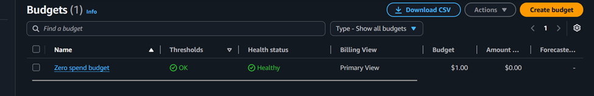
```text
Рисунок 1 — AWS Budget ZeroSpend
```

### Контрольный вопрос

**Что разрешает политика `AdministratorAccess`? Почему для повседневной работы нельзя использовать root?**

Политика `AdministratorAccess` предоставляет практически полный доступ к ресурсам AWS. Root-пользователь имеет максимальные привилегии в аккаунте, поэтому для повседневной работы следует использовать IAM-пользователя с необходимыми правами, а root применять только для специальных административных операций.

---

# 4. Задание 2. Запуск экземпляра EC2

Был создан экземпляр EC2 со следующими параметрами:

* имя: `webserver`;
* AMI: Amazon Linux 2023;
* тип экземпляра: `t3.micro`;
* регион: `eu-central-1`;
* публичный IP-адрес включён;
* Security Group: `webserver-sg`.

Для подключения по SSH был создан ключ:

```text
garizan_fiodor-keypair.pem
```

В Security Group были настроены следующие правила:

| Протокол | Порт | Источник  |
| -------- | ---: | --------- |
| SSH      |   22 | My IP     |
| HTTP     |   80 | 0.0.0.0/0 |

Для автоматической установки nginx был использован User Data:

```bash
#!/bin/bash
dnf -y update
dnf -y install htop nginx
systemctl enable --now nginx
```

После запуска экземпляра были успешно пройдены проверки состояния.

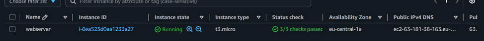
```text
Рисунок 2 — Запущенный экземпляр EC2
```

После запуска nginx стала доступна стандартная страница веб-сервера по публичному IP-адресу экземпляра.

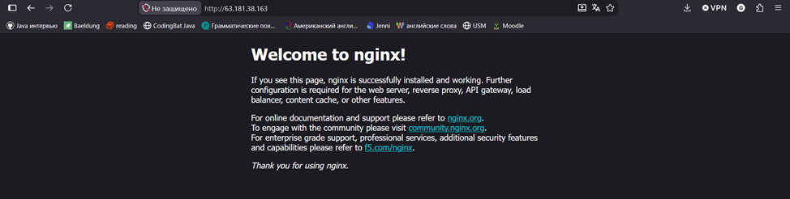

```text
Рисунок 3 — Стандартная страница nginx
```

### Контрольный вопрос

**Что такое User Data и когда выполняется этот скрипт? Выполнится ли он повторно после перезагрузки экземпляра?**

User Data позволяет передать экземпляру EC2 скрипт начальной настройки. В данной работе он использовался для установки nginx и его запуска. Обычная перезагрузка экземпляра сама по себе не запускает этот скрипт заново.

---

# 5. Задание 3. Мониторинг и диагностика

Для экземпляра были просмотрены:

* System status check;
* Instance status check;
* Attached EBS status check;
* метрики CloudWatch;
* системный лог;
* снимок экрана экземпляра.

Базовый мониторинг предоставляет метрики с интервалом в несколько минут. Детальный мониторинг позволяет получать их чаще и используется в случаях, когда требуется более оперативное наблюдение за нагрузкой.

В системном логе были найдены сообщения, связанные с выполнением User Data и установкой nginx.

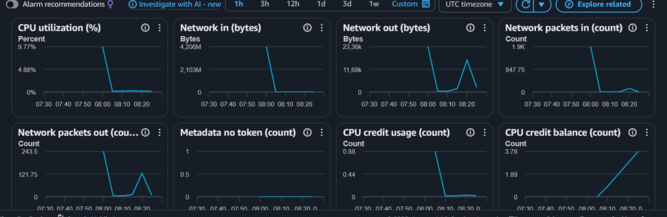
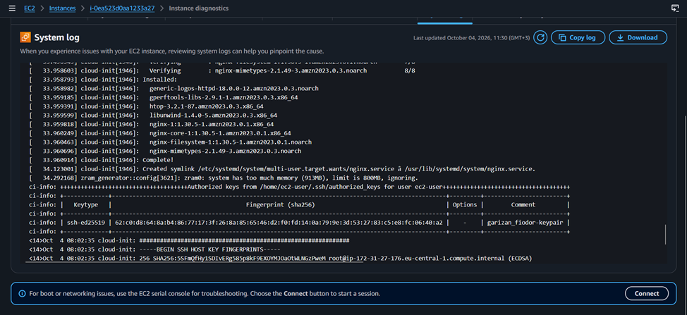
```text
Рисунок 4 — Мониторинг и системный лог
```

### Контрольный вопрос

**Какая проверка укажет на проблему, которую можете исправить вы, а какая — на проблему AWS?**

`Instance status check` относится к состоянию самой виртуальной машины и операционной системы. `System status check` относится к инфраструктуре AWS, на которой работает экземпляр. `Attached EBS status check` показывает состояние подключённых EBS-томов.

**В каких случаях стоит включать детальный мониторинг?**

Детальный мониторинг имеет смысл включать, когда требуется более частое получение метрик для анализа производительности, диагностики или оперативного реагирования на изменение нагрузки.

---

# 6. Задание 4. Подключение по SSH

Для подключения к экземпляру EC2 использовался приватный ключ:

```text
garizan_fiodor-keypair.pem
```


Подключение выполнялось командой:

```bash
ssh -i "D:/Program Files/загрузки/garizan_fiodor-keypair.pem" ec2-user@<Public-IP>
```

После подключения была выполнена проверка состояния nginx:

```bash
systemctl status nginx
```

Сервис nginx находился в состоянии `active (running)`.

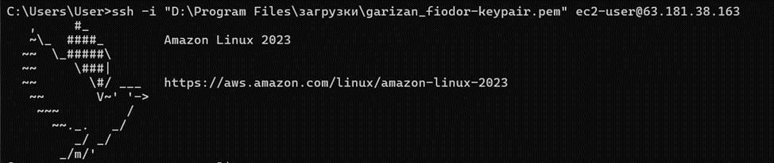
```text
Рисунок 5 — SSH и nginx
```

### Контрольный вопрос

**Почему для входа на экземпляр EC2 используется ключ, а не пароль?**

SSH-ключ позволяет выполнять криптографическую аутентификацию без передачи обычного пароля. Приватный ключ хранится у пользователя, а соответствующий открытый ключ используется сервером для проверки подключения.

---

# 7. Задание 5. Статический сайт

Для проверки работы nginx были созданы три HTML-страницы:

```text
index.html
about.html
contact.html
```

Страницы содержали ссылки друг на друга.

Для передачи файлов на сервер использовалась команда:

```bash
scp -i "D:/Program Files/загрузки/garizan_fiodor-keypair.pem" index.html about.html contact.html ec2-user@<Public-IP>:~
```

После подключения к серверу файлы были скопированы в директорию nginx:

```bash
sudo cp ~/*.html /usr/share/nginx/html/
```

Наличие файлов было проверено командой:

```bash
ls -l /usr/share/nginx/html
```

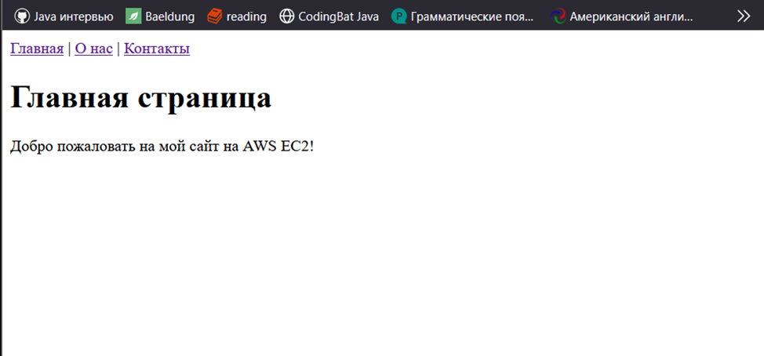
```text
Рисунок 6 — Статический сайт
```

### Контрольный вопрос

**Что делает команда `scp` и чем она похожа на `ssh`?**

`scp` используется для безопасного копирования файлов между компьютером и удалённым сервером. Для соединения используется SSH, поэтому для `scp` применяются те же SSH-ключи и механизм аутентификации.

---

# 8. Задание 6. Остановка экземпляра через AWS CLI

Экземпляр EC2 был остановлен с использованием AWS CLI:

```bash
aws ec2 stop-instances --instance-ids i-0ea523d0a1233a27 --region eu-central-1
```

Команда была выполнена через AWS CloudShell.

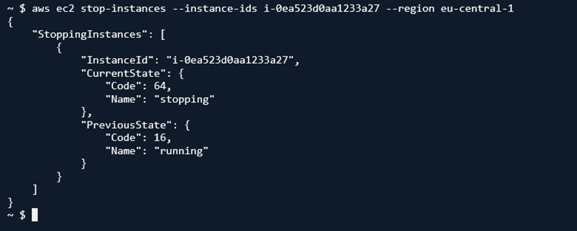

```text
Рисунок 7 — Остановка EC2 через AWS CLI
```

### Контрольный вопрос

**Чем `Stop` отличается от `Terminate`? За что продолжается оплата после остановки?**

`Stop` останавливает вычисления экземпляра, но сохраняет сам экземпляр и его EBS-тома. `Terminate` удаляет экземпляр. После остановки EC2 вычислительная стоимость экземпляра не начисляется, однако EBS и другие сохраняемые ресурсы могут продолжать тарифицироваться.

---

# 9. Задание 7. GitHub Organization и репозиторий

Для хранения исходного кода была создана GitHub Organization:

```text
garizan-cloud
```

В организации был создан публичный репозиторий:

```text
timecapsule
```

В репозиторий было загружено приложение:

```text
open_capsules_php_functional
```

Исходный код был получен командой:

```bash
git clone https://github.com/msu-cloud-course/app-samples.git
```

После этого был создан локальный репозиторий приложения и выполнена первоначальная отправка:

```bash
git init -b main
git add .
git commit -m "Initial import of TimeCapsule"
git remote add origin https://github.com/<nickname>-cloud/timecapsule.git
git push -u origin main
```

В корне репозитория находятся основные директории приложения:

```text
public
src
views
```

а также:

```text
composer.json
```

Файлы `.env` и `vendor/` в репозиторий не добавлялись.

### Контрольный вопрос

**Почему `vendor/` и `.env` не попали в репозиторий?**

Они исключены правилами `.gitignore`. Файл `.env` содержит конфиденциальные параметры, в частности пароль базы данных, поэтому его нельзя помещать в публичный репозиторий. Каталог `vendor/` содержит зависимости, которые можно установить на сервере с помощью Composer.

---

# 10. Задание 8. Подготовка сервера

После повторного запуска экземпляра был получен новый публичный IP-адрес.

На сервере были установлены необходимые пакеты:

```bash
sudo dnf -y install git composer postgresql16-server \
php8.4-fpm php8.4-cli php8.4-pgsql php8.4-mbstring php8.4-xml
```

Были проверены версии PHP и наличие расширения PostgreSQL:

```bash
php -v
php -m | grep pdo_pgsql
```

Таким образом, сервер был подготовлен для запуска PHP-приложения с PostgreSQL.

### Контрольный вопрос

**Почему эти пакеты устанавливаются вручную, а не добавляются в User Data?**

В данной лабораторной работе установка пакетов для продвинутой части выполняется вручную после подготовки базового сервера. Это позволяет отдельно увидеть и проверить компоненты, необходимые непосредственно приложению.

---

# 11. Задание 9. PostgreSQL

Была инициализирована база данных PostgreSQL:

```bash
sudo postgresql-setup --initdb
```

После проверки конфигурации `pg_hba.conf` метод подключения `ident` был заменён на:

```text
scram-sha-256
```

Команда изменения:

```bash
sudo sed -i 's/ident$/scram-sha-256/' /var/lib/pgsql/data/pg_hba.conf
```

PostgreSQL был запущен и добавлен в автозапуск:

```bash
sudo systemctl enable --now postgresql
```

Для приложения был создан отдельный пользователь:

```text
timecapsule
```

и база данных:

```text
timecapsule
```

После этого было проверено подключение:

```bash
psql -h localhost -U timecapsule -d timecapsule -c "SELECT 1;"
```

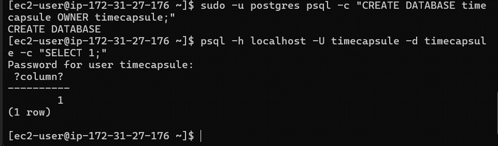

```text
Рисунок 8 — Проверка PostgreSQL
```

Использование отдельного пользователя базы данных позволяет отделить права приложения от административного пользователя PostgreSQL.

---

# 12. Задание 10. Развёртывание приложения

Для приложения была создана директория:

```text
/var/www/timecapsule
```

Команды:

```bash
sudo mkdir -p /var/www/timecapsule
sudo chown ec2-user:ec2-user /var/www/timecapsule
```

Исходный код был загружен непосредственно из публичного GitHub-репозитория:

```bash
git clone https://github.com/<nickname>-cloud/timecapsule.git /var/www/timecapsule
```

Для хранения конфигурации приложения был создан файл:

```text
.env
```

В нём были указаны параметры подключения к PostgreSQL и другие настройки приложения.

Права доступа были настроены командами:

```bash
chmod 640 .env
sudo chgrp apache .env
sudo chown -R apache:apache storage
```

После этого были установлены PHP-зависимости:

```bash
composer install --no-dev --optimize-autoloader
```

Инициализация базы данных:

```bash
php bin/init-db.php
```


```text
Рисунок 9 — Инициализация базы данных приложения
```

### Контрольный вопрос

**Почему пароль к базе хранится в `.env`, а не в коде?**

Пароль является конфиденциальным параметром и не должен находиться в исходном коде публичного репозитория. Файл `.env` хранится непосредственно на сервере и исключён из Git.

**Почему публичный репозиторий безопасен для этого приложения?**

Исходный код приложения может быть публичным, поскольку конфиденциальные данные, включая пароль базы данных, не находятся в репозитории.

---

# 13. Задание 11. Настройка PHP-FPM и nginx

Для загрузки файлов был увеличен лимит PHP:

```bash
sudo sed -i 's/^upload_max_filesize.*/upload_max_filesize = 6M/' /etc/php.ini
```

Для nginx был создан конфигурационный файл:

```text
/etc/nginx/conf.d/timecapsule.conf
```

В конфигурации:

* nginx принимает HTTP-запросы на порту 80;
* корнем приложения является `/var/www/timecapsule/public`;
* запросы к существующим статическим файлам обслуживаются nginx;
* остальные запросы передаются в `index.php`;
* PHP-запросы передаются PHP-FPM;
* доступ к скрытым файлам запрещён.

Конфигурация была проверена:

```bash
sudo nginx -t
```

После этого был запущен PHP-FPM:

```bash
sudo systemctl enable --now php-fpm
```

и перезапущен nginx:

```bash
sudo systemctl restart nginx
```

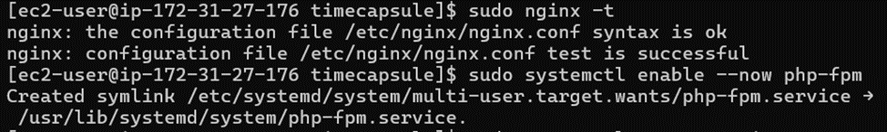
```text
Рисунок 10 — Проверка конфигурации nginx
```

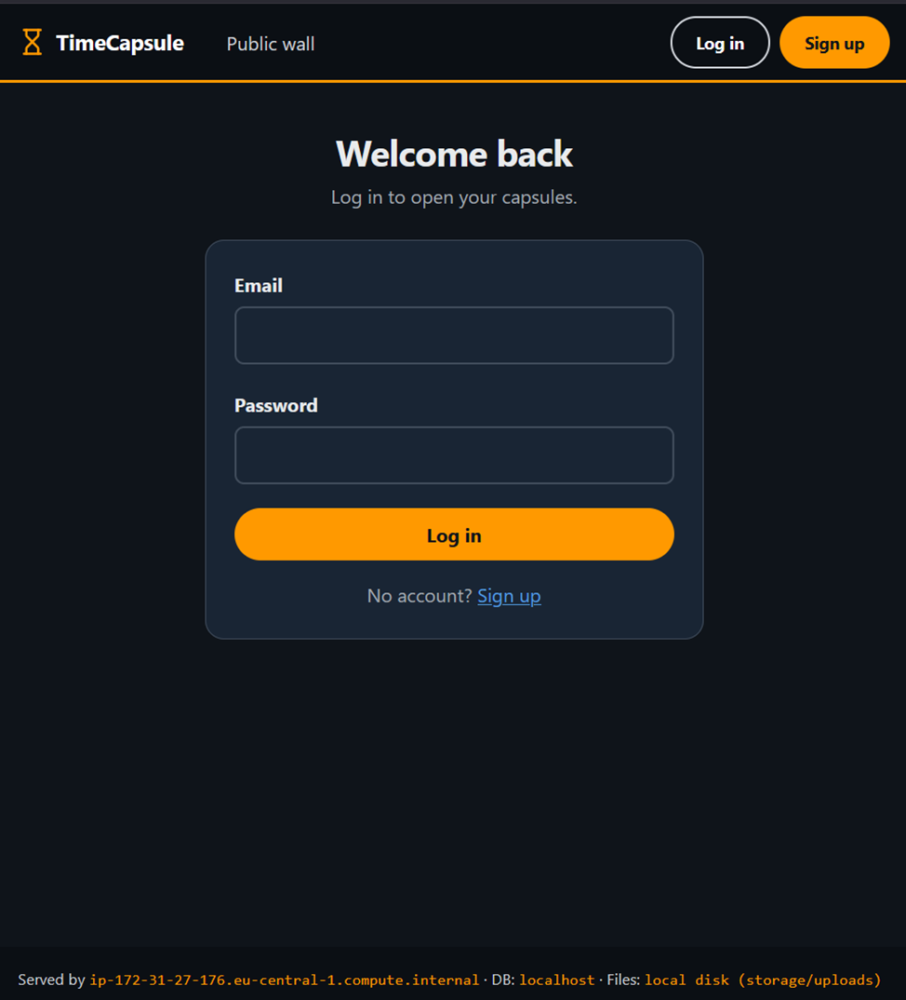
```text
Рисунок 11 — TimeCapsule
```

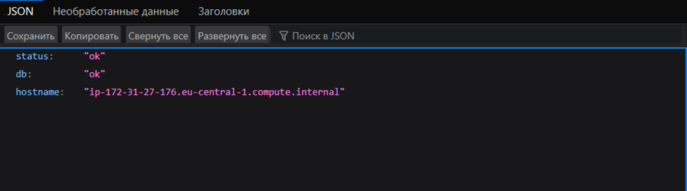
```text
Рисунок 12 — Health check
```

Endpoint `/health` подтвердил, что приложение работает и имеет соединение с базой данных.

---

# 14. Задание 12. Обновление приложения

Для автоматизации развёртывания был создан скрипт:

```text
~/deploy.sh
```

Скрипт выполняет следующие операции:

1. переходит в директорию приложения;
2. получает новый код через `git pull --ff-only`;
3. устанавливает PHP-зависимости;
4. инициализирует необходимые таблицы;
5. выполняет reload PHP-FPM;
6. выводит текущий коммит.

Скрипт имеет вид:

```bash
#!/bin/bash
set -euo pipefail

cd /var/www/timecapsule

echo "==> Забираем новый код из GitHub"
git pull --ff-only

echo "==> Устанавливаем библиотеки"
composer install --no-dev --optimize-autoloader --no-interaction

echo "==> Создаём недостающие таблицы"
php bin/init-db.php

echo "==> Перезапускаем PHP-FPM"
sudo systemctl reload php-fpm

echo "Готово. На сервере коммит: $(git log -1 --oneline)"
```

Скрипту были предоставлены права на выполнение:

```bash
chmod +x ~/deploy.sh
```

Деплой можно запускать непосредственно со своего компьютера:

```bash
ssh -i "D:/Program Files/загрузки/garizan_fiodor-keypair.pem" ec2-user@<Public-IP> ./deploy.sh
```

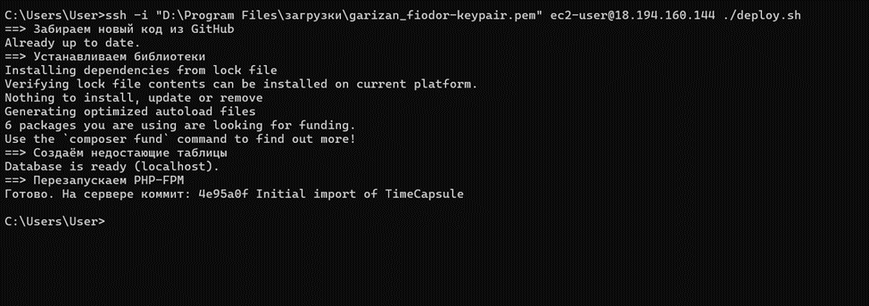
```text
Рисунок 13 — Деплой через deploy.sh
```

Использование скрипта уменьшает количество ручных действий и делает процесс обновления повторяемым.

---

# 15. Задание 13. Новая версия, ошибка и откат

## 15.1 Выпуск новой версии

В приложение было внесено заметное изменение — в нижнюю часть страницы добавлена информация об авторе.

После изменения был создан коммит:

```bash
git add views/layout.php
git commit -m "Show author in footer"
git push
```

После этого был выполнен деплой на сервер.

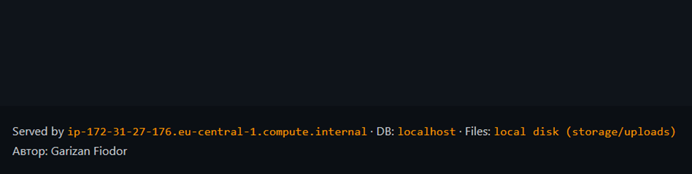
```text
Рисунок 14 — Новая версия приложения
```

---

## 15.2 Намеренная поломка

Для проверки процедуры восстановления в приложение была внесена синтаксическая ошибка.

Изменение было отправлено в GitHub и выполнен новый деплой.

После этого главная страница приложения стала возвращать ошибку:

```text
HTTP 500
```

При этом endpoint:

```text
/health
```

продолжал работать.

### Почему `/health` мог продолжать работать?

`/health` проверяет определённую часть работоспособности приложения, включая соединение с базой данных. Успешный ответ `/health` не означает, что все страницы и пользовательские сценарии приложения работают корректно.

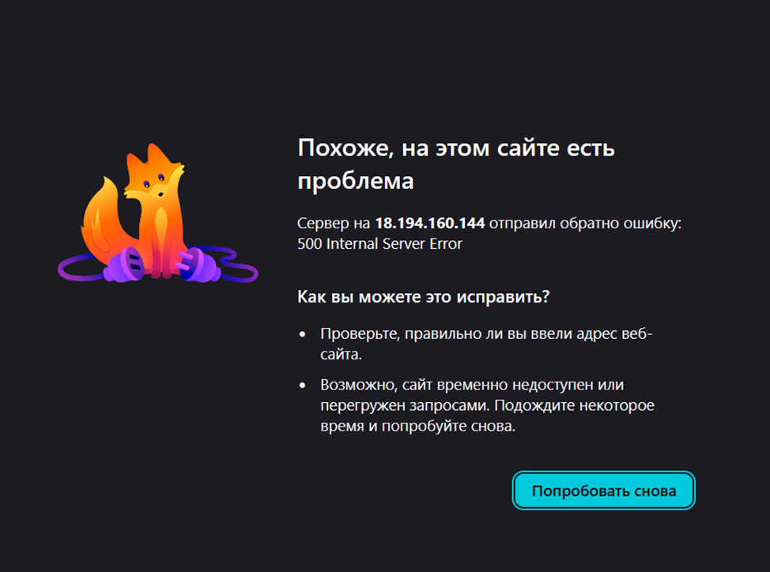
```text
Рисунок 15 — Ошибка 500
```

---

## 15.3 Откат

Для восстановления предыдущей рабочей версии использовалась команда:

```bash
git revert --no-edit HEAD
```

После этого изменения были отправлены в GitHub:

```bash
git push
```

Затем снова был выполнен:

```bash
ssh -i "D:/Program Files/загрузки/garizan_fiodor-keypair.pem" ec2-user@<Public-IP> ./deploy.sh
```

После повторного деплоя приложение снова стало работать.

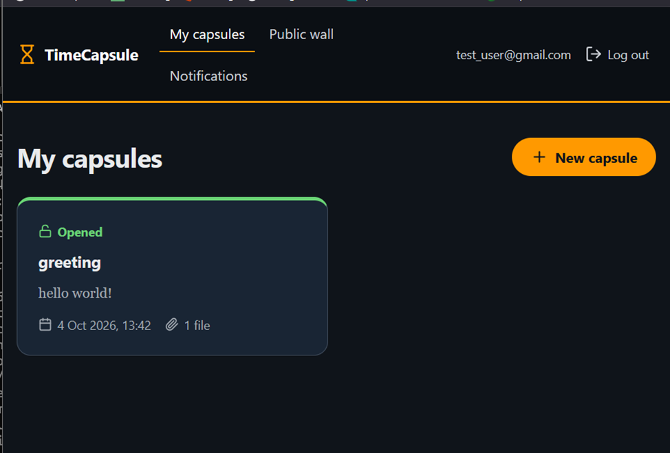
```text
Рисунок 16 — Работа приложения после отката
```

### Анализ

Время простоя приложения складывалось из времени обнаружения ошибки, определения причины, выполнения отката и повторного деплоя.

Сократить время простоя можно с помощью автоматизированных тестов, CI/CD, автоматической проверки новой версии перед публикацией и более безопасных стратегий развёртывания.

---

# 16. Задание 14. Архитектура

Развёртывание состоит из AWS-инфраструктуры, сервера приложения и внешнего GitHub-репозитория.

Пользователь отправляет HTTP-запрос на публичный адрес EC2. Запрос поступает в nginx. Статические файлы nginx отдаёт самостоятельно, а PHP-запросы передаёт PHP-FPM.

PHP-FPM выполняет PHP-код приложения. Для хранения данных приложение использует PostgreSQL, работающий на том же экземпляре EC2.

Исходный код хранится в GitHub. Сервер получает его из публичного репозитория по HTTPS.

Разработчик отправляет изменения с локального компьютера в GitHub с помощью `git push`. Деплой на сервер запускается по SSH.

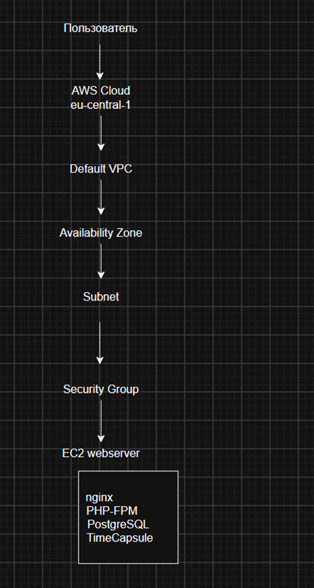
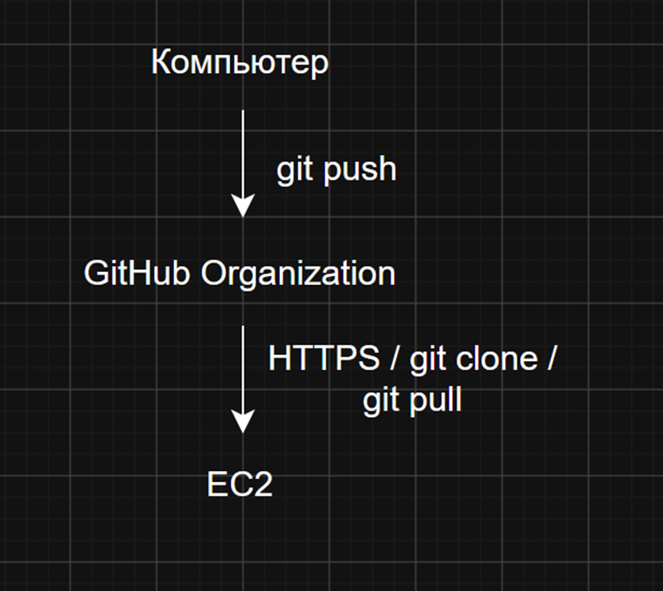
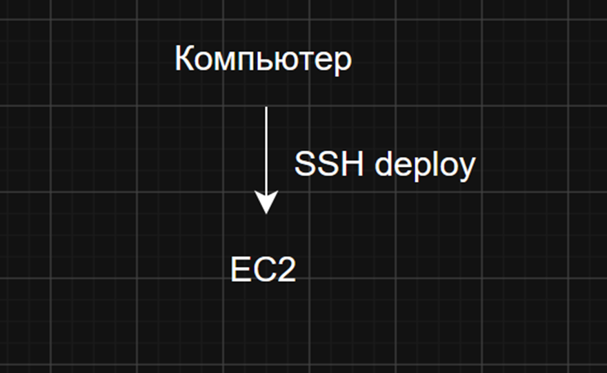
```text
Рисунок 17 — Архитектура развёртывания
```

---

# 17. Architecture Decision Record

Файл ADR расположен по адресу:

```text
docs/adr/0001-deploy-method.md
```

## ADR-0001. Способ доставки кода

**Статус:** принято

**Дата:** `2026.10.04`

### Контекст

Приложение TimeCapsule необходимо разворачивать на EC2 и регулярно обновлять его исходный код. Необходимо выбрать способ доставки изменений с учётом простоты, повторяемости и возможности контролировать версии приложения.

### Решение

Для развёртывания выбран скрипт `deploy.sh`.

Скрипт автоматически выполняет получение нового кода из GitHub, установку зависимостей, инициализацию базы данных и перезагрузку PHP-FPM.

### Рассмотренные альтернативы

#### 1. Копирование через `scp`

`scp` позволяет напрямую передавать файлы с компьютера на сервер.

Преимущество — простота для небольших статических сайтов.

Недостаток — сложнее контролировать версии приложения, а также легко забыть скопировать отдельный файл.

#### 2. Ручной `git pull`

Сервер может получать код непосредственно из GitHub с помощью `git pull`.

По сравнению с `scp` этот вариант лучше контролирует версии исходного кода.

Однако оператору приходится самостоятельно выполнять несколько команд после получения изменений.

#### 3. Скрипт `deploy.sh`

Скрипт объединяет необходимые действия в одну повторяемую процедуру.

Это уменьшает количество ручных операций и вероятность того, что один из этапов обновления будет пропущен.

### Последствия

Положительным результатом является простой и повторяемый процесс деплоя, при котором исходный код хранится в GitHub, а версия приложения определяется коммитом Git.

Недостатком является отсутствие полноценной автоматизации CI/CD: запуск деплоя всё ещё выполняется вручную, а автоматические тесты перед выпуском версии не используются.

---

# 18. Ответы на дополнительные контрольные вопросы

## 18.1 Как проходит запрос от браузера до базы данных?

Браузер отправляет HTTP-запрос на публичный IP-адрес EC2. Запрос принимает nginx.

Если требуется статический файл, nginx отдаёт его непосредственно. Если требуется выполнение PHP, nginx передаёт запрос PHP-FPM через Unix-сокет.

PHP-FPM выполняет код приложения TimeCapsule. При необходимости приложение обращается к PostgreSQL на локальном сервере.

Таким образом, цепочка выглядит следующим образом:

```text
Браузер
   ↓ HTTP
nginx
   ↓ FastCGI
PHP-FPM
   ↓
TimeCapsule
   ↓
PostgreSQL
```

---

## 18.2 Почему сервер может скачивать код из репозитория, но не может отправлять изменения?

Репозиторий является публичным, поэтому сервер может получать код через HTTPS без аутентификации.

При этом серверу не предоставлены права на изменение репозитория. Это безопаснее, поскольку компрометация сервера не должна автоматически давать злоумышленнику возможность изменять исходный код проекта.

---

## 18.3 Что произойдёт с загруженными файлами при удалении EC2?

Загруженные пользователями файлы находятся в локальном хранилище экземпляра EC2. Если удалить экземпляр вместе с его хранилищем, эти файлы могут быть потеряны.

Это связано с тем, что приложение в данной лабораторной работе хранит загруженные файлы локально, а не в отдельном долговременном объектном хранилище.

---

## 18.4 Что общего между `deploy.sh` и CI/CD?

`deploy.sh` автоматизирует последовательность действий, необходимых для публикации новой версии приложения.

Это является упрощённым вариантом того, что делают CI/CD-системы: получают новую версию кода, устанавливают зависимости, выполняют необходимые операции и разворачивают приложение.

В текущем процессе отсутствуют автоматический запуск по событию GitHub, автоматические тесты, проверки качества кода и полноценный контроль этапов выпуска.

---

# 19. Итог

В ходе лабораторной работы была создана и настроена инфраструктура для размещения веб-приложения в AWS.

Был создан экземпляр EC2 в регионе `eu-central-1`, настроены IAM, Security Group и бюджет AWS. На сервере был установлен nginx, после чего были изучены мониторинг и диагностика EC2.

Во второй части работы исходный код приложения TimeCapsule был размещён в GitHub Organization. На EC2 были установлены PHP-FPM и PostgreSQL, создана база данных, настроено приложение и nginx.

Для обновления приложения был создан скрипт `deploy.sh`. В рамках проверки процесса обновления была выпущена новая версия приложения, затем намеренно создана ошибка, после чего выполнен откат с помощью `git revert`.

В результате была получена рабочая схема развёртывания, в которой GitHub является источником исходного кода, а EC2 используется как сервер приложения с nginx, PHP-FPM и PostgreSQL.

---

# 20. Список использованных источников

1. Методические материалы лабораторной работы по AWS.
2. Документация AWS по EC2, IAM, CloudWatch и AWS CLI.
3. Документация Git и GitHub.
4. Документация nginx.
5. Документация PHP и PHP-FPM.
6. Документация PostgreSQL.
