# Лабораторная работа №3. Создание и настройка Amazon VPC в AWS
**ФИО:** `Гаризан Фёдор`
**Группа:** `IA2403`

## 1. Цель работы

Изучить принципы построения изолированной виртуальной сети в Amazon Web Services (AWS), создать VPC с публичными и приватными подсетями, настроить таблицы маршрутизации и группы безопасности, развернуть виртуальные машины EC2 и проверить сетевое взаимодействие между ними.

## 2. Исходные данные

- **Облачная платформа:** Amazon Web Services (AWS).
- **Вариант:** \(k = 15\).
- **Параметр варианта:** \(X = k \bmod 30 = 15\).
- **Имя VPC:** `timecapsule-dev-vpc`.
- **Регион:** `eu-central-1` (Frankfurt).
- **Диапазон адресов VPC:** `10.15.0.0/16`.

## 3. Задание 1. Планирование IP-адресации

Для создаваемой виртуальной сети был выбран диапазон `10.15.0.0/16`. Внутри него были выделены четыре подсети: две публичные и две приватные, расположенные в разных зонах доступности.

| Подсеть | Зона доступности | CIDR | Назначение |
|---|---|---|---|
| `public-a` | `eu-central-1a` | `10.15.0.0/24` | Публичные ресурсы |
| `public-b` | `eu-central-1b` | `10.15.1.0/24` | Bastion-хост |
| `private-a` | `eu-central-1a` | `10.15.10.0/24` | Сервер базы данных |
| `private-b` | `eu-central-1b` | `10.15.11.0/24` | Резерв для приватных ресурсов |

Каждая подсеть `/24` содержит 256 адресов, из которых AWS резервирует 5. Таким образом, для ресурсов доступен 251 IP-адрес в каждой подсети.

## 4. Задание 2. Создание VPC и подсетей

Была создана виртуальная частная сеть `timecapsule-dev-vpc` с диапазоном IPv4 `10.15.0.0/16`.

Для VPC были предусмотрены параметры DNS resolution и DNS hostnames. Затем были созданы четыре подсети в соответствии с разработанным планом адресации.

**Скриншот 1 — Созданные подсети.**

## 5. Задание 3. Настройка интернет-шлюза и таблиц маршрутизации

Для публичного доступа был создан Internet Gateway с именем `timecapsule-dev-igw` и подключён к VPC.

Для публичных подсетей была настроена таблица маршрутизации `timecapsule-dev-public-rt`. В неё добавлен маршрут `0.0.0.0/0` через Internet Gateway. К этой таблице были привязаны подсети `public-a` и `public-b`.

Для приватных подсетей создана таблица `timecapsule-dev-private-rt`. В ней не предусматривался прямой маршрут в интернет через Internet Gateway. К таблице были привязаны `private-a` и `private-b`.

Для публичных подсетей также был включён автоматический запуск назначения публичного IPv4-адреса экземплярам EC2.

**Скриншот 2 — Internet Gateway.**  

## 6. Задание 4. Настройка групп безопасности

Для ограничения сетевого доступа были созданы три группы безопасности.

| Группа безопасности | Порт | Источник | Назначение |
|---|---:|---|---|
| `timecapsule-dev-bastion-sg` | TCP 22 | Мой публичный IP `/32` | SSH-доступ к bastion-хосту |
| `timecapsule-dev-web-sg` | TCP 80 | `0.0.0.0/0` | HTTP-доступ к веб-серверу |
| `timecapsule-dev-web-sg` | TCP 22 | `timecapsule-dev-bastion-sg` | SSH-доступ через bastion |
| `timecapsule-dev-db-sg` | TCP 5432 | `timecapsule-dev-web-sg` | Подключение к PostgreSQL с веб-сервера |
| `timecapsule-dev-db-sg` | TCP 22 | `timecapsule-dev-bastion-sg` | SSH-доступ к серверу БД через bastion |

Использование ссылок на группы безопасности позволяет ограничить доступ между экземплярами, а не открывать административные порты для всех IP-адресов.

## 7. Задание 5. Создание экземпляров EC2

В созданной сети были предусмотрены три экземпляра EC2:

| Экземпляр | Подсеть | Группа безопасности | Публичный IP |
|---|---|---|---|
| Bastion-хост | `public-b` | `timecapsule-dev-bastion-sg` | Да |
| Web-сервер | `public-a` | `timecapsule-dev-web-sg` | Да |
| Сервер БД | `private-a` | `timecapsule-dev-db-sg` | Нет |

Для экземпляров использовалась Amazon Linux 2023 и подходящий для лабораторной работы тип инстанса. Для веб-сервера был подготовлен пользовательский скрипт и настроен веб-сервис Nginx.

Для административного доступа к приватному серверу БД используется Bastion-хост в публичной подсети. Это позволяет не назначать серверу БД публичный IP-адрес.

**Скриншот 3 — Сеть сервера БД.** 

## 8. Задание 6. Временный NAT Gateway и настройка PostgreSQL

Для установки пакетов на приватном сервере БД был временно создан NAT Gateway `timecapsule-dev-nat-a` в публичной подсети. Для него был выделен Elastic IP.

В таблицу маршрутизации приватных подсетей временно добавлялся маршрут `0.0.0.0/0` через NAT Gateway. Это позволило приватному экземпляру обращаться к внешним ресурсам для установки необходимых пакетов, не предоставляя ему прямого входящего доступа из интернета.

На сервере БД был установлен PostgreSQL 16. Были выполнены необходимые действия по инициализации базы данных и настройке параметров прослушивания и правил доступа PostgreSQL. Для лабораторной работы была предусмотрена база данных `lab3` и пользователь `student`.

После завершения настройки временный NAT Gateway был удалён, временный маршрут из приватной таблицы маршрутизации удалён, а неиспользуемый Elastic IP освобождён.

**Скриншот 4 — PostgreSQL.**  

## 9. Задание 7. Проверка сетевой связности и безопасности

После настройки серверов были выполнены проверки сетевого взаимодействия.

Проверки должны подтвердить следующие ожидаемые результаты:

1. Веб-сервер доступен по HTTP на TCP-порту 80.
2. Подключение к PostgreSQL на TCP-порту 5432 разрешено с веб-сервера при корректной настройке PostgreSQL и группы безопасности БД.
3. Подключение к PostgreSQL с bastion-хоста не разрешается, если для него нет соответствующего разрешающего правила.
4. Приватный сервер БД не имеет публичного IPv4-адреса и после удаления NAT Gateway не использует временный маршрут через NAT для доступа в интернет.
5. Временное правило Network ACL, применённое для проверки фильтрации трафика, после теста удалено.
6. Ресурсам назначены необходимые теги.

**Скриншот 5 — Подключение к PostgreSQL с веб-сервера.**  

**Скриншот 6 — Проверка ограничения доступа.**  

**Скриншот 7 — Проверка приватности сервера БД.**  

**Скриншот 8 — Теги ресурсов и итоговое состояние.**  

## Шаг 8. Создание AMI и нового app-server
### 8.3. Создание AMI старого веб-сервера

С работающего сервера webserver создан AMI timecapsule-dev-app-lab2 с ID ami-049515c22cfd290bd. Образ имеет тип machine, архитектуру x86_64, корневое устройство EBS и статус Available. К образу добавлен тег Project=timecapsule.

**Скриншот 9 — AMI timecapsule-dev-app-lab2 в статусе Available.**
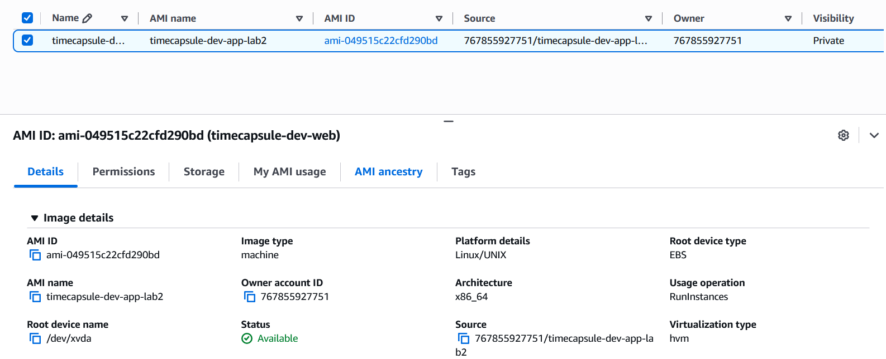

### 8.4. Запуск нового app-server

Из AMI запущен экземпляр timecapsule-dev-app:

    Instance ID: i-035f4eb6c80075c2c
    Тип: t3.micro
    VPC: timecapsule-dev-vpc
    Подсеть: public-a
    Availability Zone: eu-central-1a
    Security Group: web-sg
    Приватный IP: 10.15.0.223
    Временный публичный IP при запуске: 3.75.92.253

User Data не использовался, поскольку приложение уже установлено в AMI. Старый webserver оставался запущенным до проверки нового экземпляра.

**Скриншот 10 — список экземпляров EC2 (новый timecapsule-dev-app в состоянии Running, старый webserver ещё не удалён) и сведения о новом экземпляре с приватным IP 10.15.0.223.**
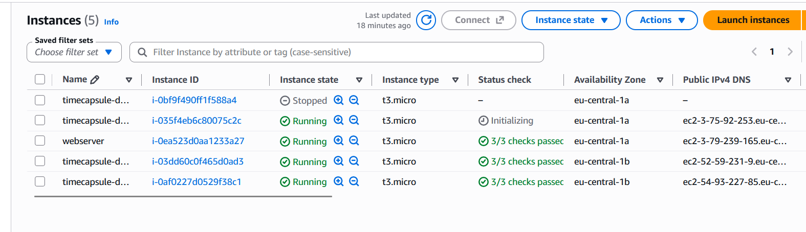
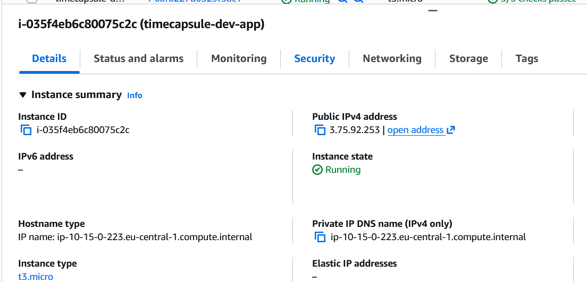

Для подключения через bastion в ~/.ssh/config добавлен блок Host app с приватным IP 10.15.0.223 и параметром ProxyJump bastion.
## Шаг 9. Elastic IP

Выделен Elastic IP 63.182.50.88 с Allocation ID eipalloc-037bc4f9ca3af7443 и тегами проекта. Адрес привязан к экземпляру timecapsule-dev-app (i-035f4eb6c80075c2c), у которого приватный IP 10.15.0.223.

После привязки приложение проверено в браузере по адресу http://63.182.50.88/login.
**Скриншот 11 — Elastic IP 63.182.50.88, привязанный к i-035f4eb6c80075c2c (приватный IP 10.15.0.223), и страница приложения TimeCapsule по адресу http://63.182.50.88/login.**
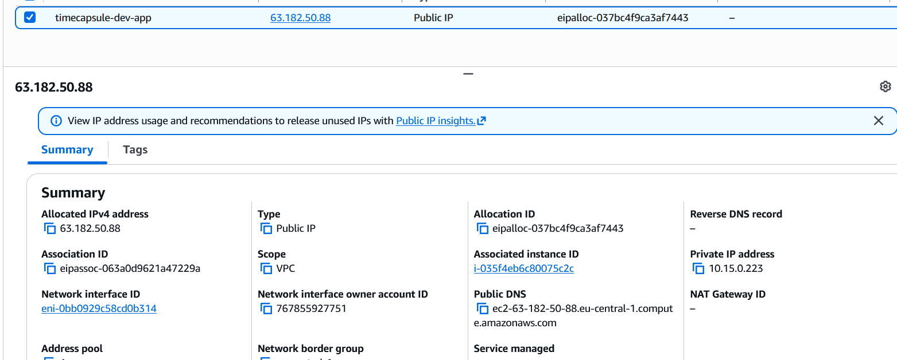
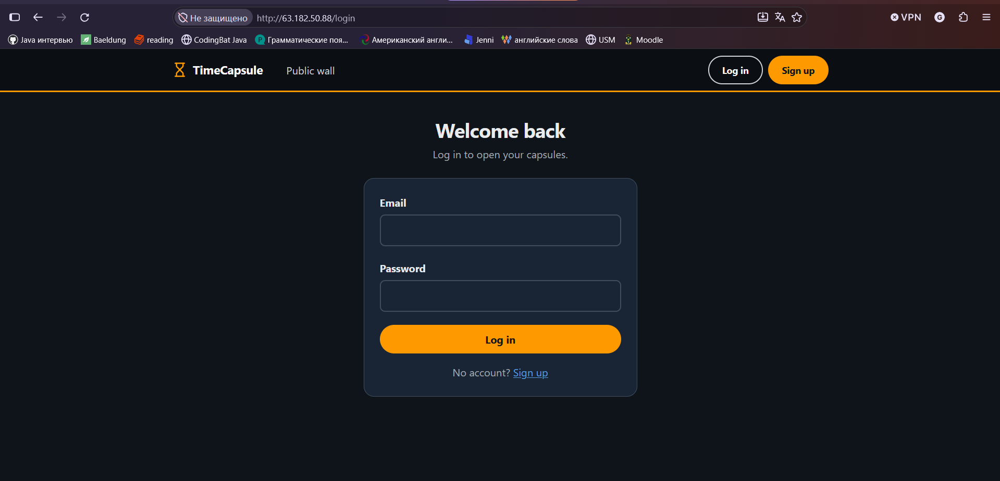

## Шаг 10. Вынос базы данных на db-server
### 10.1. Создание пользователя и базы данных

На приватном сервере db-server с IP-адресом 10.15.10.254 создан пользователь PostgreSQL timecapsule с новым паролем, отличным от использованного в лабораторной работе №2. Создана база данных timecapsule, владельцем которой является пользователь timecapsule. Пароль в отчёте не приводится.
### 10.2. Ограничение доступа в pg_hba.conf

Широкие правила, ранее разрешавшие подключение всем пользователям и ко всем базам из подсетей 10.15.0.0/24 и 10.15.1.0/24, заменены правилом:
host    timecapsule    timecapsule    10.15.0.0/24    scram-sha-256

Правило разрешает пользователю timecapsule подключаться к базе timecapsule из подсети public-a. CIDR 10.15.0.0/24 проверен в AWS. После изменения конфигурации PostgreSQL перезапущен; служба находится в состоянии active (running) и включена в автозапуск.
**Скриншот 12 — systemctl restart postgresql и systemctl status postgresql на db-server: служба active (running).**
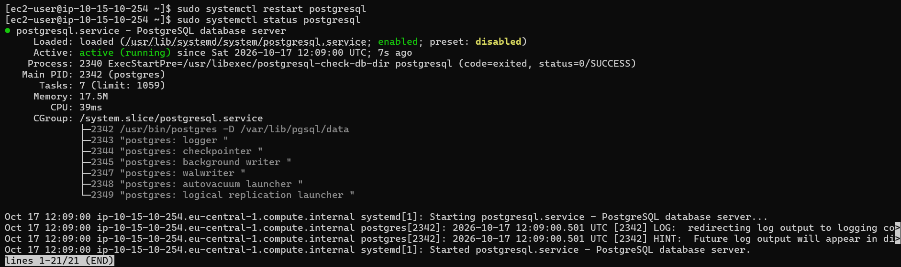

### 10.3. Импорт данных

Дамп timecapsule.sql импортирован с app-server на удалённую базу командой:
psql -h db.timecapsule.internal -U timecapsule -d timecapsule -f timecapsule.sql

Проверка командой \dt показала таблицы capsules, notifications и users с владельцем timecapsule.

### 10.4. Настройка приложения и отключение локальной БД

В /var/www/timecapsule/.env настроены параметры подключения к удалённой БД:

    DB_HOST=db.timecapsule.internal
    DB_PORT=5432
    DB_NAME=timecapsule
    DB_USER=timecapsule
    DB_PASSWORD=<новый пароль>

Пароль хранится в конфигурации сервера и не публикуется в отчёте. Для файла .env назначена группа apache и права 640, чтобы PHP-FPM мог прочитать конфигурацию. После перезапуска PHP-FPM endpoint здоровья подтвердил доступность базы данных.

Локальный PostgreSQL на app-server отключён и удалён из автозапуска:
sudo systemctl disable --now postgresql

Проверка curl -s http://localhost/health вернула "status":"ok" и "db":"ok".
**Скриншот 13 — ответ curl -s http://localhost/health: "status":"ok", "db":"ok".**
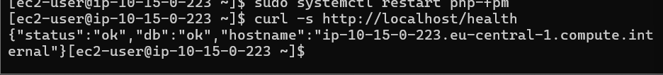

## Шаг 11. Приватная зона Route 53
### 11.1–11.2. Создание зоны и DNS-записи

Создана приватная Hosted Zone timecapsule.internal, связанная с VPC timecapsule-dev-vpc в регионе eu-central-1. Для VPC включены параметры DNS resolution и DNS hostnames. К зоне добавлен тег проекта.

Создана DNS-запись со следующими параметрами:
Поле	Значение
Record name	db.timecapsule.internal
Тип	A
Значение	10.15.10.254
TTL	60
Routing policy	Simple
**Скриншот 14 — запись db.timecapsule.internal типа A со значением 10.15.10.254 и TTL 60 в Route 53.**
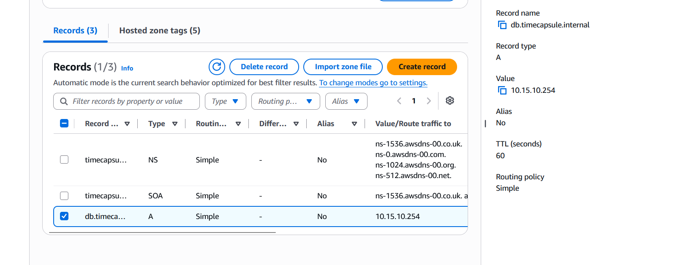

### 11.3. Проверка DNS

На app-server выполнена команда:
dig +short db.timecapsule.internal

Команда вернула приватный IP сервера БД 10.15.10.254. Приложение использует DNS-имя db.timecapsule.internal для подключения к базе, поэтому при изменении IP-адреса БД достаточно обновить DNS-запись, не меняя имя хоста в конфигурации приложения.
**Скриншот 15 — результат dig +short db.timecapsule.internal на app-server.**
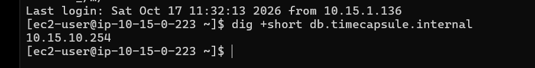

Приватное имя не разрешается с домашнего компьютера, поскольку приватная Hosted Zone доступна через DNS внутри связанной VPC или через специально настроенное подключение к ней.

## Шаг 13. Проверка отказоустойчивости и обновление ОС
### 13.1. Видимое изменение приложения

В шаблон views/layout.php добавлен видимый текст LR3. Изменение закоммичено и отправлено в GitHub. Поскольку скрипта deploy.sh в репозитории нет, код на сервере обновлён вручную.

### 13.2. Остановка и восстановление БД

Экземпляр db-server остановлен и затем запущен снова. Пока БД была недоступна, endpoint /health сообщал об ошибке подключения к базе, а страница приложения возвращала ошибку HTTP 500. После повторного запуска сервера /health снова вернул "db":"ok" без изменения конфигурации app-server. Приватный IP сервера БД сохранился, а PostgreSQL запускается автоматически.

### 13.3. Обновление db-server через временный NAT Gateway

Поскольку db-server не имеет публичного IP-адреса и прямого маршрута в интернет, для обновления ОС временно создан NAT Gateway nat-02ce8086139eac1b6 в публичной подсети public-a с Elastic IP 63.184.181.254. В таблицу маршрутизации timecapsule-dev-private-rt добавлен маршрут 0.0.0.0/0 через этот NAT Gateway.

На db-server выполнена команда:
sudo dnf -y update
echo $?

Команда завершилась без ошибок; код возврата echo $? равен 0. Система сообщила о доступности более новых релизов Amazon Linux, но обновление до них не требовалось.

После обновления временная инфраструктура удалена в следующем порядке:

    Удалён маршрут 0.0.0.0/0 из приватной таблицы маршрутизации.
    Удалён NAT Gateway.
    Освобождён Elastic IP 63.184.181.254.

После очистки остался один Elastic IP — 63.182.50.88, привязанный к timecapsule-dev-app.
**Скриншот 16 — sudo dnf -y update на db-server и echo $? с результатом 0.**
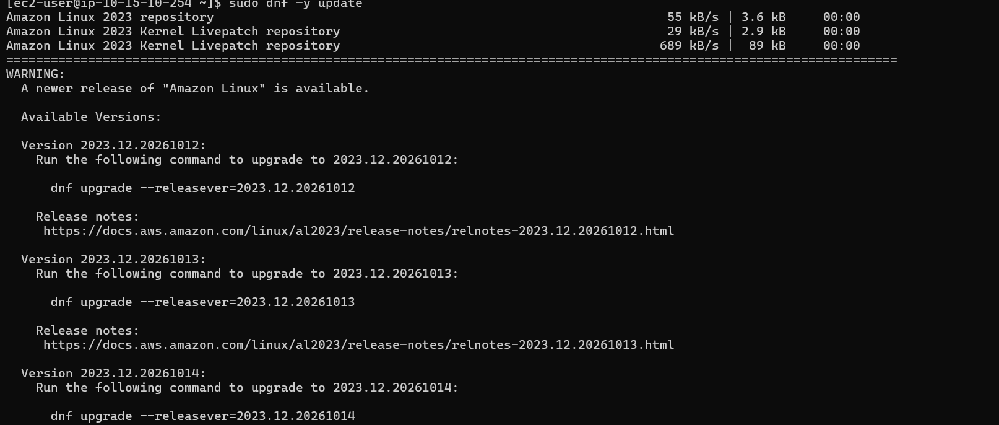
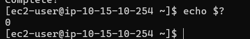

## Шаг 14. Архитектурная диаграмма

Архитектурная диаграмма отражает итоговую инфраструктуру:

    пользователь и GitHub находятся вне AWS;
    регион AWS — eu-central-1;
    VPC — timecapsule-dev-vpc;
    показаны две зоны доступности и четыре подсети;
    Internet Gateway обеспечивает входящий доступ к публичному приложению;
    серверы bastion, timecapsule-dev-app и db-server показаны с соответствующими группами безопасности;
    приватная зона Route 53 timecapsule.internal разрешает имя db.timecapsule.internal;
    app-server подключается к PostgreSQL на db-server по приватному DNS-имени и порту 5432;
    временный NAT Gateway показан пунктиром как ресурс, использовавшийся только для обновления ОС приватного сервера.
**Скриншот 17 — архитектурная диаграмма проекта.**
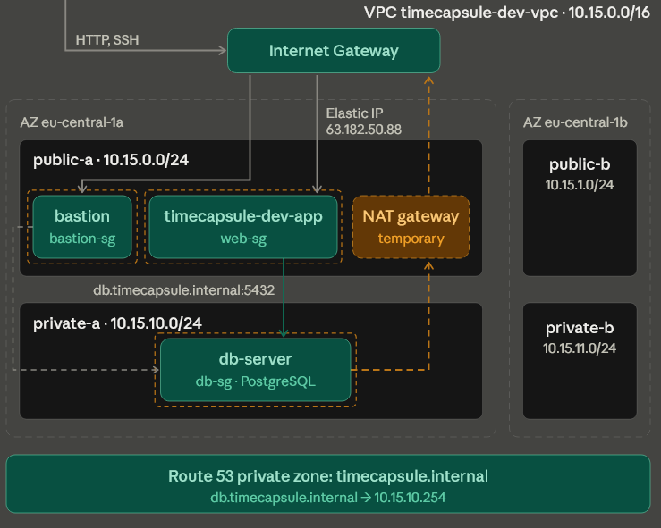

## 15. Вывод

В ходе лабораторной работы была рассмотрена организация виртуальной сети в AWS с использованием VPC, публичных и приватных подсетей, Internet Gateway, таблиц маршрутизации и групп безопасности.

Была изучена схема размещения bastion-хоста, веб-сервера и сервера базы данных в разных подсетях. Настройка правил сетевого доступа позволяет предоставлять сервисам только необходимые соединения. Временное использование NAT Gateway демонстрирует способ предоставления исходящего доступа приватному серверу для установки программного обеспечения без назначения ему публичного IP-адреса.

Приложение перенесено на новый сервер, созданный из AMI, и доступно по постоянному Elastic IP. База данных вынесена на изолированный сервер в приватной подсети без публичного адреса. Доступ к ней ограничен правилом pg_hba.conf для одного пользователя, одной базы и одной подсети, а также группой безопасности. Приватное DNS-имя db.timecapsule.internal отделяет конфигурацию приложения от IP-адреса БД. Обновление ОС приватного сервера выполнено через временный NAT, который сразу удалён вместе с маршрутом и Elastic IP, что исключает лишние расходы и лишние пути в интернет.