# Лабораторная работа №4. Облачные хранилища. Amazon S3

- **ФИО:** Гаризан Фёдор
- **Группа:** IA2403

# Часть 1. Базовый уровень

## Задание 1. Бакет и объекты в консоли

Создан бакет `timecapsule-dev-uploads-garizan`: General purpose, ACLs disabled, Block all public access, версионирование выключено, шифрование SSE-S3, теги (`Lab=lab4` и остальные обязательные).


В бакет загружены папки `uploads/` (картинка и PDF) и `backups/` (текстовый файл).

Свойства картинки:

| Параметр | Значение |
|---|---|
| Ключ | `uploads/12.jpg` |
| Content-Type | `image/jpeg` |
| ETag | `da8846bdea74051b4b8bbcd588b6a561` |
| Object URL | `https://timecapsule-dev-uploads-garizan.s3.eu-central-1.amazonaws.com/uploads/12.jpg` |

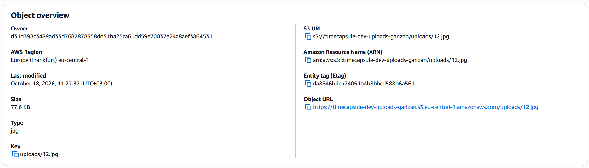

**Ответы:**

- **Какой ключ у картинки?** `uploads/12.jpg`. В S3 нет настоящих папок, ключ — это единая строка. Слэш в ней является просто символом, а консоль показывает его как вложенность.
- **Почему Object URL не открывается?** Бакет закрыт настройкой Block all public access, а в браузере запрос приходит без подписи, то есть анонимно. Права владельца действуют только для запросов, подписанных его учётными данными, поэтому S3 отвечает AccessDenied.
- **Что создала кнопка Create folder?** Пустой объект нулевого размера с ключом, заканчивающимся на `/` (например, `uploads/`). Консоль показывает его как папку.

## Задание 2. Объекты из командной строки

Вывод трёх команд (`aws s3 ls s3://$BUCKET`, `aws s3 ls s3://$BUCKET/uploads/`, `aws s3 ls s3://$BUCKET --recursive`):

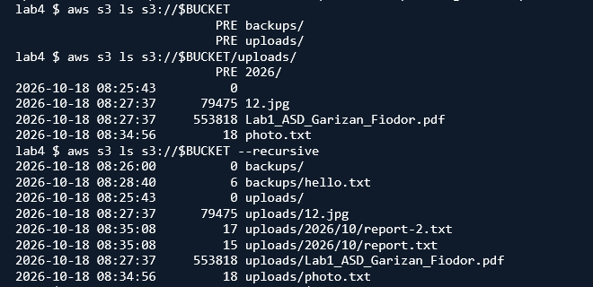

Метаданные через `head-object` (для картинки и для `uploads/2026/10/report.txt`):
**Ответы:**

- **Почему первая команда показывает `PRE uploads/` и `PRE backups/`, а третья полные ключи?** Без `--recursive` CLI запрашивает список с разделителем `/` и сворачивает всё, что лежит глубже, в общие префиксы (`PRE`). С `--recursive` разделитель не используется, поэтому выводятся все ключи целиком.
- **Какой Content-Type получил `report.txt`?** `text/plain`. Я его не указывал: CLI определяет тип по расширению файла `.txt`.

## Задание 3. Политика бакета: только HTTPS

Политика бакета:

```json
{
  "Version": "2012-10-17",
  "Statement": [
    {
      "Sid": "DenyInsecureTransport",
      "Effect": "Deny",
      "Principal": "*",
      "Action": "s3:*",
      "Resource": [
        "arn:aws:s3:::timecapsule-dev-uploads-garizan",
        "arn:aws:s3:::timecapsule-dev-uploads-garizan/*"
      ],
      "Condition": {
        "Bool": { "aws:SecureTransport": "false" }
      }
    }
  ]
}
```

Проверка: первая команда (по HTTPS) выводит список объектов, вторая (`--endpoint-url http://...`) получает AccessDenied с пометкой `explicit deny in a resource-based policy`.

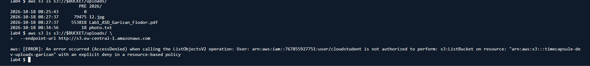

**Ответы:**

- **Почему вторая команда получила AccessDenied, хотя у меня права администратора?** Явный запрет (`Deny`) всегда сильнее любого разрешения. Права администратора — это `Allow`, а политика бакета запрещает все запросы с `aws:SecureTransport = false`. Запрос по `http://` под это условие попадает.
- **Почему Block Public Access не помешал сохранить политику с `"Principal": "*"`?** Block Public Access блокирует политики, которые *дают* публичный доступ. Моя политика только запрещает, поэтому доступ она не открывает, а сужает.

## Задание 4. Версионирование и защита от удаления

Список версий `notes.txt` (v1 и v2) после двух загрузок:

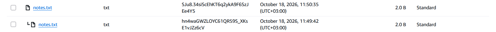

**Ответы:**

- **Чем удаление в шаге 3 отличается от удаления в шаге 5?** В шаге 3 удаление идёт без указания версии: S3 ничего не стирает, а добавляет маркер удаления (Delete marker). В шаге 5 удалялась конкретная версия `v2`, и она стёрта окончательно. Поэтому консоль просит подтверждение вида `permanently delete`.
- **Какое из них можно отменить?** Удаление из шага 3: достаточно удалить маркер, и объект возвращается. Удаление из шага 5 отменить нельзя.
- **Какой способ защищает, а какой нужно запрещать приложению?** От случайного удаления защищает вариант с маркером: все версии остаются. Удаление конкретных версий (`s3:DeleteObjectVersion`) нужно запрещать приложению, чтобы нельзя было уничтожить историю.

## Задание 5. Правило жизненного цикла

Правило `timecapsule-dev-noncurrent`:

| Параметр | Значение |
|---|---|
| Область действия | префикс `uploads/` (`backups/` не затрагивается) |
| Неактуальные версии → Standard-IA | через 30 дней |
| Удаление неактуальных версий | через 90 дней, оставлять 2 самые новые неактуальные версии |
| Незавершённые multipart-загрузки | удалять через 7 дней |

Форма правила и блок Review transition and expiration actions:

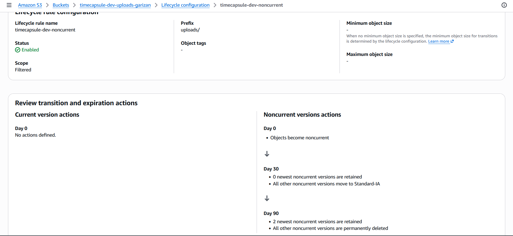

**Ответы:**

- **Что будет с файлом, перезаписанным 10 раз за неделю?** Появится 1 текущая и 9 неактуальных версий. Первые 30 дней после того, как версия стала неактуальной, все они лежат в Standard. Затем каждая версия по очереди (в день своего 30-го дня) переходит в Standard-IA. Через 90 дней после перехода в неактуальные версия удаляется, но две самые новые неактуальные версии сохраняются всегда.
- **Почему маленькие тестовые файлы в Standard-IA не попадут?** У Standard-IA есть минимальный размер объекта (128 КБ). Меньшие объекты правила жизненного цикла в этот класс по умолчанию не переводят, потому что это невыгодно.
- **Что такое незавершённая загрузка частями и почему за неё платят?** Это multipart-загрузка, которую начали, но не завершили и не отменили. Уже загруженные части хранятся в бакете невидимо в списке объектов, но тарифицируются как обычные данные. Правило с авто-отменой через 7 дней убирает такие «хвосты».

## Задание 6. Подписанные URL

Шаг 1. Ссылка из консоли на 5 минут, картинка открылась:

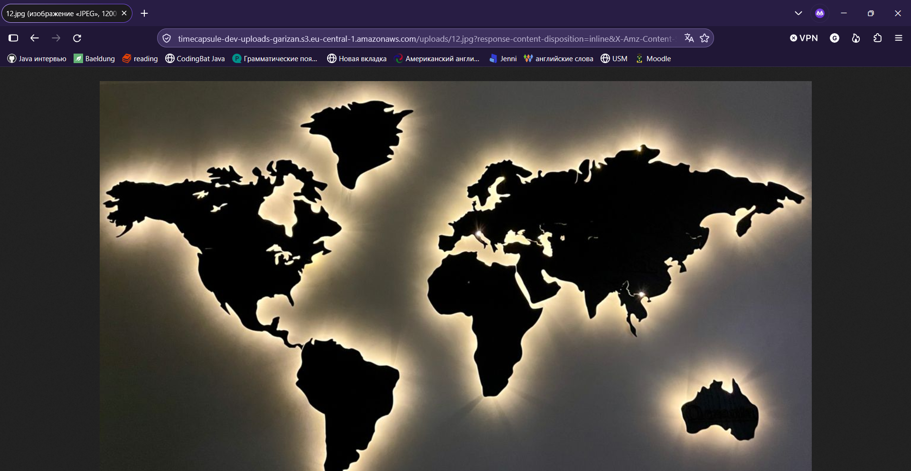

Шаг 2. Ссылка из CLI (`aws s3 presign s3://$BUCKET/uploads/photo.txt --expires-in 120`) открылась в браузере:

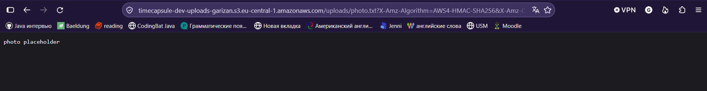

Шаг 3. Ответ S3 при подмене `photo.txt` на `notes.txt` (SignatureDoesNotMatch):

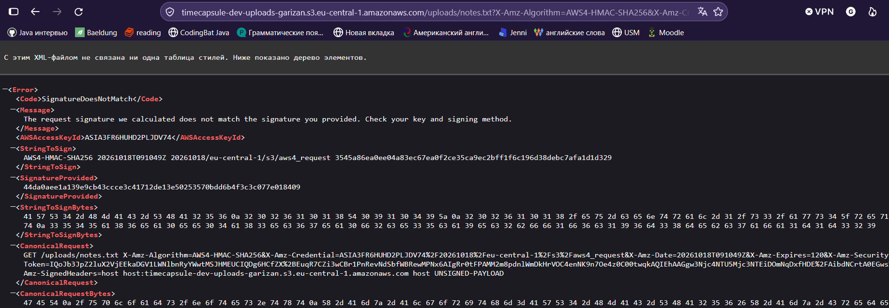

Шаг 4. Ответ S3 на просроченную ссылку (AccessDenied, Request has expired):


**Ответы:**

- **Какие ошибки вернул S3?** Шаг 3: `403 SignatureDoesNotMatch`. Шаг 4: `403 AccessDenied` с сообщением `Request has expired`.
- **Почему нельзя получить другой файл, просто изменив ключ?** Ключ (как и метод, срок и заголовки) входит в строку, которая подписывается секретным ключом. После изменения ключа подпись перестаёт совпадать с запросом, и S3 её отвергает.
- **Обращалась ли `aws s3 presign` к S3?** Нет. Подпись считается локально по учётным данным и параметрам запроса, сеть при этом не используется. Поэтому ссылку можно сделать даже на несуществующий объект.

Временные файлы удалены: `cd ~ && rm -rf lab4`.

---

# Часть 2. Продвинутый уровень

## Задания 7–8. Политика приложения и проверка через тестовую роль

Документ политики `timecapsule-dev-app-s3`:

```json
{
  "Version": "2012-10-17",
  "Statement": [
    {
      "Sid": "ListUploadsPrefix",
      "Effect": "Allow",
      "Action": "s3:ListBucket",
      "Resource": "arn:aws:s3:::timecapsule-dev-uploads-garizan",
      "Condition": {
        "StringLike": { "s3:prefix": ["uploads/*"] }
      }
    },
    {
      "Sid": "ObjectsUnderUploads",
      "Effect": "Allow",
      "Action": ["s3:GetObject", "s3:PutObject", "s3:DeleteObject"],
      "Resource": "arn:aws:s3:::timecapsule-dev-uploads-garizan/uploads/*"
    }
  ]
}
```

Политика `timecapsule-dev-app-s3` в IAM (вкладка Summary, 5 тегов; желательно добавить ещё скрин вкладки JSON):

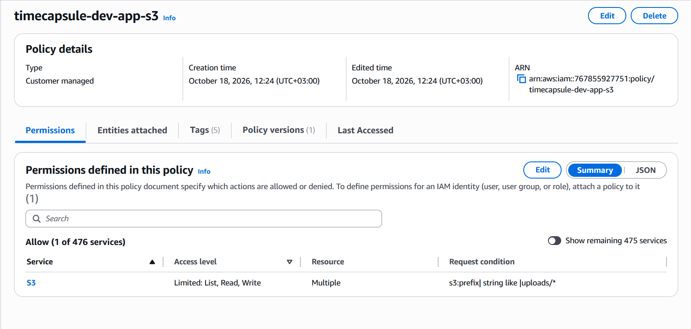

Получение роли (`assume-role`) и `aws sts get-caller-identity` от имени тестовой роли (`assumed-role/timecapsule-dev-s3-tester/lab4`):

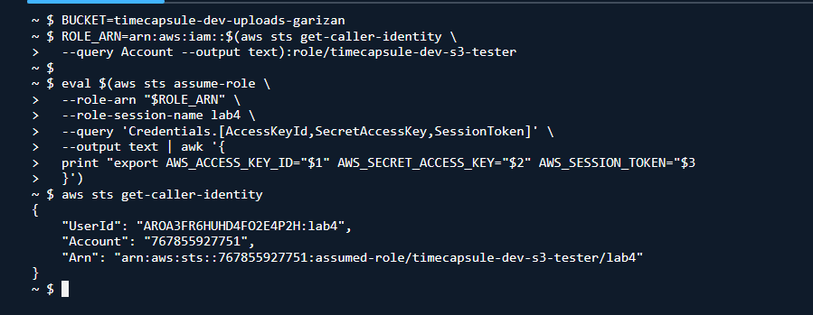

Таблица проверки прав:

| № | Команда | Ожидаю | Получил | Какое правило сработало |
|---|---|---|---|---|
| 1 | `aws s3 cp test.txt s3://$BUCKET/uploads/test.txt` | Разрешено | Разрешено | Разрешение в политике приложения (`s3:PutObject` на `uploads/*`) |
| 2 | `aws s3 ls s3://$BUCKET/uploads/` | Разрешено | Разрешено | Разрешение в политике приложения (`s3:ListBucket`, `prefix=uploads/`) |
| 3 | `aws s3 ls s3://$BUCKET` | AccessDenied | AccessDenied | Неявный запрет (пустой prefix не подходит под условие) |
| 4 | `aws s3 cp s3://$BUCKET/uploads/photo.txt -` | Разрешено | Разрешено | Разрешение в политике приложения (`s3:GetObject`) |
| 5 | `aws s3 ls s3://$BUCKET/backups/` | AccessDenied | AccessDenied | Неявный запрет (prefix вне `uploads/`) |
| 6 | `aws s3 cp test.txt s3://$BUCKET/backups/test.txt` | AccessDenied | AccessDenied | Неявный запрет (ресурс вне `uploads/*`) |
| 7 | `aws s3api list-object-versions --bucket $BUCKET --prefix uploads/` | AccessDenied | AccessDenied | Неявный запрет (нет `s3:ListBucketVersions`) |
| 8 | `aws s3api delete-object ... --version-id <VersionId>` | AccessDenied | AccessDenied | Неявный запрет (нет `s3:DeleteObjectVersion`) |
| 9 | `aws s3 rm s3://$BUCKET/uploads/test.txt` | Разрешено | Разрешено | Разрешение в политике приложения (`s3:DeleteObject`; создаётся маркер удаления) |
| 10 | `aws s3 ls s3://$BUCKET/uploads/ --endpoint-url http://...` | AccessDenied | AccessDenied | Явный запрет в политике бакета (HTTPS) |

Вывод команд 1–3:

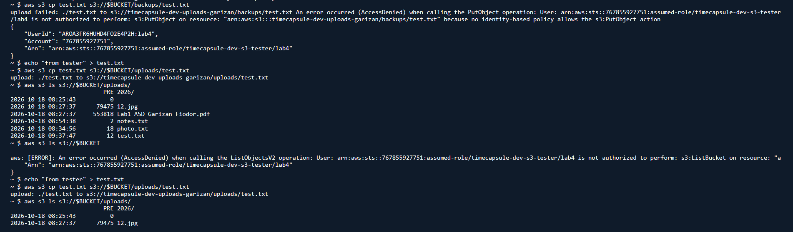

Вывод команд 3–10:

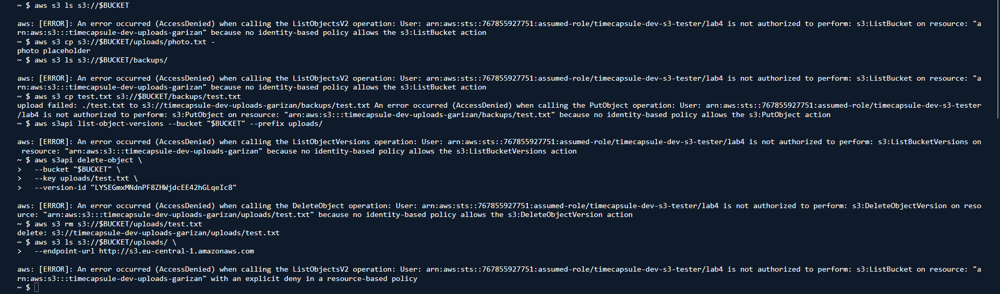

**Ответы:**

- **Чем политика доверия роли отличается от политики прав?** Политика доверия отвечает на вопрос, *кто* может взять роль на себя (`sts:AssumeRole`): у тестовой роли это мой аккаунт. Политика прав определяет, *что* можно делать, уже имея роль: действия и ресурсы S3.
- **Что произошло с `test.txt` после команды 9 и можно ли его восстановить?** Версионирование включено, поэтому `s3:DeleteObject` без версии создал маркер удаления, а сама версия осталась. Восстановить файл можно, удалив маркер (администратором, у роли для этого нет прав).
- **Сможет ли злоумышленник, получивший учётные данные приложения, уничтожить файлы пользователей без возможности восстановления?** Нет. Для окончательного удаления версии нужно `s3:DeleteObjectVersion`, а его в политике нет. Максимум он добавит маркеры удаления или перезапишет объекты новыми версиями, и это обратимо.
- **А если бы в политике было `s3:*`?** Тогда он мог бы удалять версии, и история пропала бы безвозвратно. Кроме того, ему стали бы доступны чтение списка и запись во всём бакете, а не только в `uploads/`.

## Задание 9. Роль сервера

Создана роль `timecapsule-dev-app-role`: AWS service → EC2, только политика `timecapsule-dev-app-s3`, теги. Роль привязана к `app-server` через Actions → Security → Modify IAM role.

Вывод на app-server: `get-caller-identity` (`assumed-role/timecapsule-dev-app-role/i-035f4eb6c80075c2c`), `ls uploads/` работает, `ls backups/` получает AccessDenied:

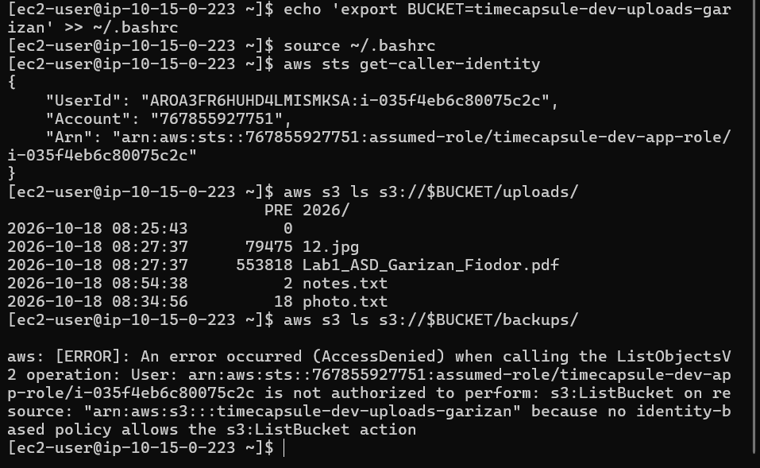

**Ответы:**

- **Откуда AWS CLI взял учётные данные?** От сервиса метаданных EC2 (IMDS). К серверу привязан профиль экземпляра с ролью, и CLI автоматически получает у метаданных временные ключи этой роли.
- **Чем политика доверия отличается от тестовой?** В тестовой роли доверие дано моему аккаунту (`AWS`), и роль берут командой `assume-role`. В роли сервера доверенным субъектом является сервис `ec2.amazonaws.com`, и роль берёт на себя сам экземпляр EC2.
- **Почему это безопаснее ключа в `.env`?** Ключи временные, ротируются автоматически и нигде не хранятся в файлах, поэтому их нельзя случайно закоммитить или забрать вместе с копией диска. Долгоживущего секрета, который можно утечь, нет.

## Задание 10. Перенос существующих файлов

Синхронизация в режиме проверки (`--dryrun`), до копирования:

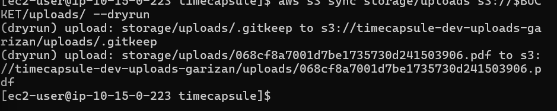

Настоящая синхронизация и повторный `--dryrun` (пустой вывод — все файлы уже в бакете):

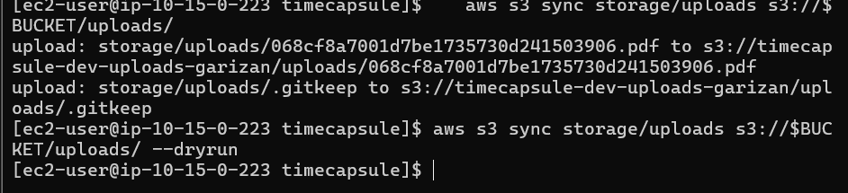

Перенесённые объекты в бакете:

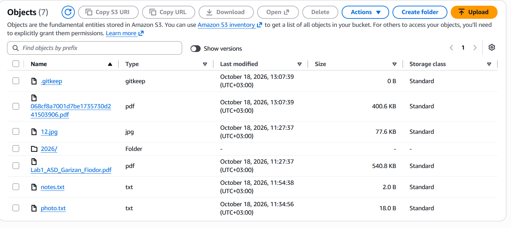

Content-Type перенесённого объекта (`application/pdf`, шифрование `AES256`):

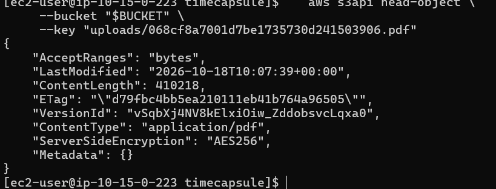

**Ответ.** Прав политики приложения хватило. `sync` использовал `s3:ListBucket` (список объектов в `uploads/`, чтобы понять, что уже есть) и `s3:PutObject` (загрузка новых и изменённых файлов).

## Задание 11. Модуль хранения на S3

Ссылка на изменения модуля хранения: <ссылка на коммит/файл в репозитории>

Что сделано:

- Подключён AWS SDK (`composer require aws/aws-sdk-php`, `composer.json` и `composer.lock` закоммичены).
- Настройки `S3_BUCKET` и `AWS_REGION` добавлены в `.env.example` и в `/var/www/timecapsule/.env` на сервере; ключей доступа в `.env` нет.
- `storage_save()`: загружает файл в `uploads/<случайное имя>` через `putObject` с `SourceFile` и корректным `ContentType` (`mime_content_type`), возвращает случайное имя.
- `storage_delete()`: `deleteObject` для `uploads/<имя>`.
- `storage_stream()`: проверка прав пользователя остаётся в приложении; затем ответ 302 на подписанный URL на 5 минут с `ResponseContentType` и `ResponseContentDisposition` (inline/attachment и исходное имя файла).
- В подвале страницы вместо `Files: local disk (storage/uploads)` выводится имя бакета.


## Задание 12. Деплой и проверка

Новый объект под `uploads/` в бакете (`31b3320ba42514a86e622dd824e39106.pdf`, 2.3 MB):

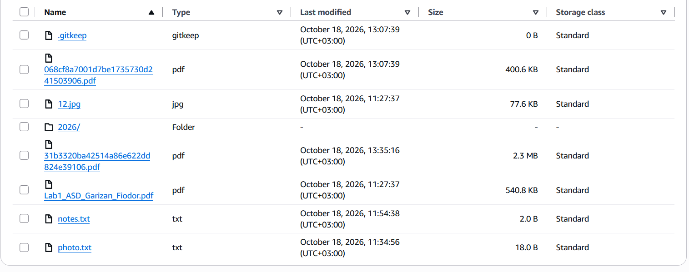

Капсула с картинкой открыта:

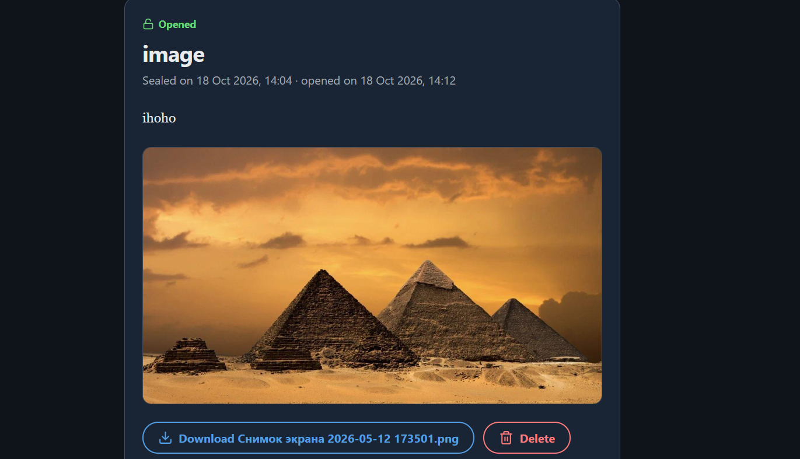

Капсула с PDF и кнопкой скачивания с исходным именем:

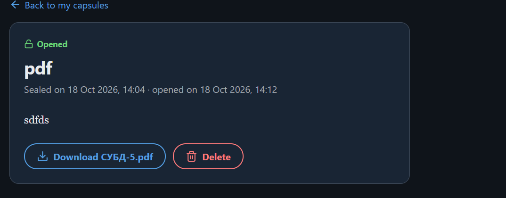

Скачанный PDF сохранился под исходным именем `СУБД-5.pdf`:

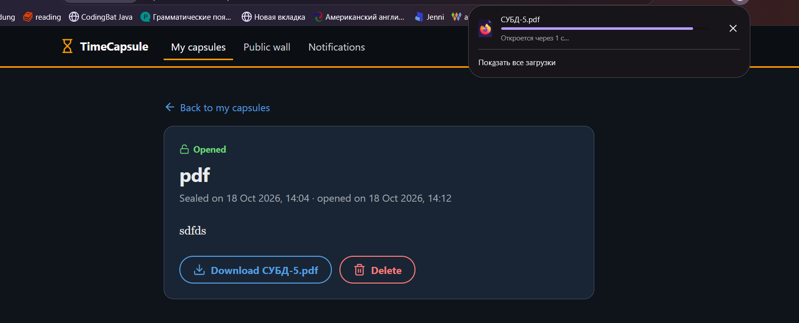

**Ответы:**

- **Почему ссылку, которую переслали другу, не нужно отзывать?** У подписанного URL короткий срок жизни (5 минут), после него S3 отвечает `Request has expired`. Ссылка сама перестаёт работать.
- **Что осталось в бакете после удаления капсулы и когда это исчезнет?** Остались маркер удаления и неактуальная версия объекта. Правило жизненного цикла удаляет неактуальные версии через 90 дней, но из-за параметра «оставлять 2 самые новые неактуальные версии» единственная версия по этому правилу не будет удалена автоматически. Чтобы объект исчез окончательно, нужно вручную удалить версию и маркер (или добавить правило очистки).

## Задание 13. Сервер без состояния

Папка `storage/uploads` перемещена в `~/uploads-backup`, php-fpm перезапущен, папки больше нет, копия удалена:

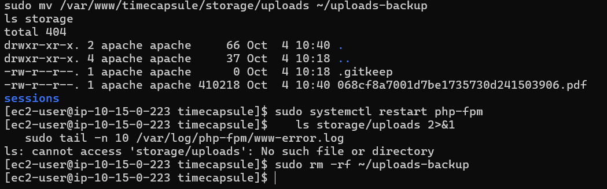

Приложение со старыми и новыми вложениями после удаления локальной папки (те же капсулы, что в задании 12):


Приложение работает, а `aws s3 ls s3://$BUCKET/uploads/` на сервере получает AccessDenied:

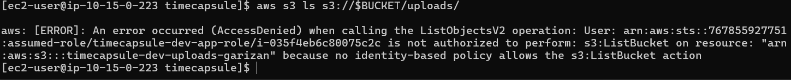

Запрос несуществующего объекта на app-server (`403 Forbidden`, роль `timecapsule-dev-app-role`):

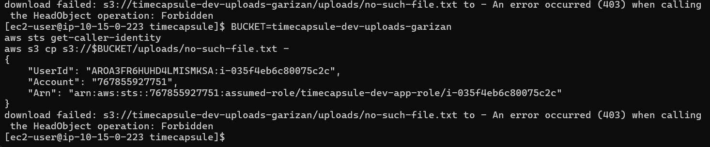

Тот же запрос в CloudShell под своим пользователем (ожидается `404`, `NoSuchKey`):

**Ответы:**

- **Почему ответы разные?** У меня в CloudShell есть `s3:ListBucket`, поэтому S3 честно сообщает, что ключа нет (`NoSuchKey`, 404). У роли сервера этого права больше нет, и S3 отвечает `AccessDenied` (403) для любого отсутствующего ключа.
- **Зачем S3 так делает?** Чтобы без права листинга нельзя было по разным ответам узнать, существует ли объект с таким именем. Различие 404/403 раскрывало бы информацию о содержимом бакета.
- **Что нужно, чтобы заменить `app-server`?** Поднять новый экземпляр с той же ролью (instance profile), положить такой же `.env` (`S3_BUCKET`, `AWS_REGION`), развернуть код и подключить его к БД. Данные пользователей лежат в S3 и БД, на сервере только код и настройки.

---

# Архитектура

Обновлённая схема (бакет S3 вне VPC, префикс `uploads/`, роль `timecapsule-dev-app-role` на app-server, стрелки PutObject/DeleteObject и скачивание браузером по подписанному URL):

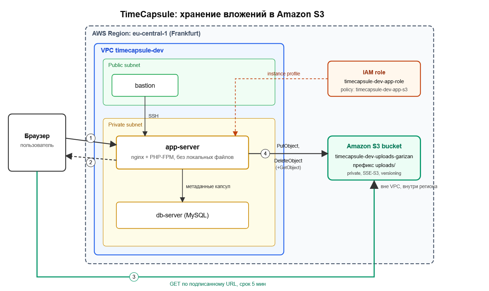

---

# Ответы на контрольные вопросы

1. **Как проходит запрос на скачивание вложения?** Браузер запрашивает у приложения вложение. Приложение проверяет права пользователя на капсулу (здесь проверяются права пользователя приложения) и, если всё в порядке, создаёт подписанный URL с помощью учётных данных роли сервера и отвечает 302. Браузер идёт по этому адресу напрямую в S3, который проверяет подпись и срок, а также то, что у роли, которой подписана ссылка, есть право `s3:GetObject` (здесь работают права роли).
2. **Что не даёт постороннему открыть вложение по прямому адресу?** Бакет закрыт Block Public Access, ACL отключены, а политика бакета запрещает запросы без HTTPS. Прямой Object URL без подписи возвращает AccessDenied. Подписанный URL привязан к конкретному ключу и действует только 5 минут, после чего перестаёт работать.
3. **Почему не открыть бакет для чтения всем?** Тогда любой, узнавший или подобравший ключ, получил бы вложение без проверки прав, а приложение не смогло бы ограничить доступ до времени открытия капсулы и владельцем. Подписанный URL оставляет проверку в приложении и ограничивает доступ по времени.
4. **Как изменится схема, если вложения должны пережить отказ региона?** Нужно включить кросс-региональную репликацию (CRR) в бакет другого региона (версионирование на обоих бакетах обязательно), а также иметь вторую копию инфраструктуры (сервер, БД) в резервном регионе и переключение через DNS (Route 53). Приложение должно уметь обращаться к бакету резервного региона.