# Лабораторная работа №5. Amazon RDS for PostgreSQL
Выполнил: Гаризан Фёдор, IA2403

## Цель работы

Изучить размещение базы данных PostgreSQL в Amazon RDS, настройку сетевого доступа к ней, подключение с виртуального сервера EC2, создание реплики для чтения и восстановление данных с помощью резервного копирования и восстановления на определённый момент времени.

В работе была выполнена базовая часть лабораторной работы — задания 1–5. Все учебные ресурсы создавались в регионе AWS `eu-central-1`. База данных размещалась в приватной сети и не имела прямого публичного доступа.

## Задание 1. Размещение и настройка доступа к базе данных

На первом этапе была подготовлена сетевая инфраструктура для размещения Amazon RDS. Для этого использовалась VPC, созданная в лабораторной работе №3.

Была создана группа подсетей `lab5-db-subnets`, в которую включены две приватные подсети `private-a` и `private-b`, расположенные в разных зонах доступности. Такая конфигурация позволяет Amazon RDS размещать базу данных в одной из указанных подсетей и поддерживает возможность использования другой зоны при необходимости.

Рисунок 1 — Группа подсетей `lab5-db-subnets`.

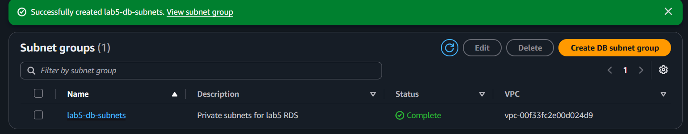

Далее была создана группа безопасности `lab5-web-sg` для сервера, с которого выполняется подключение к базе данных. В правилах входящего трафика был предусмотрен SSH-доступ для администрирования сервера.

Рисунок 2 — Группа безопасности `lab5-web-sg`.

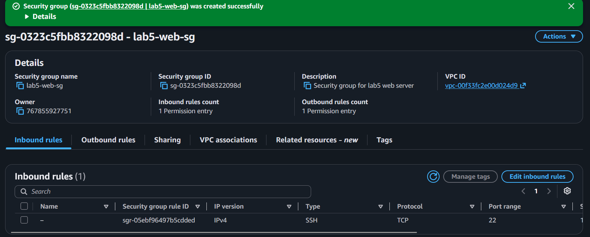

Для базы данных была создана отдельная группа безопасности `lab5-rds-sg`. В ней настроено правило входящего трафика PostgreSQL по TCP-порту `5432`. В качестве источника указана группа безопасности `lab5-web-sg`, поэтому подключения к базе разрешены только от серверов, которым назначена эта группа.

Рисунок 3 — Правило доступа к PostgreSQL в группе безопасности `lab5-rds-sg`.

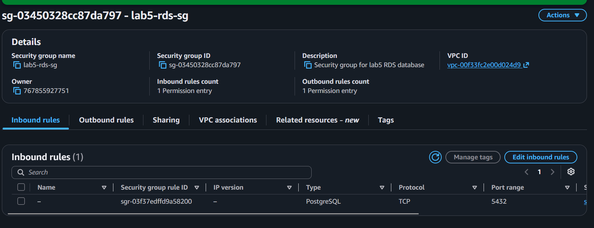

Использование Security Group в качестве источника удобнее, чем указание конкретного IP-адреса: при изменении IP-адреса сервера правило продолжает действовать, если серверу назначена соответствующая группа безопасности. Две приватные подсети указаны для того, чтобы группа подсетей RDS включала разные зоны доступности и могла использоваться при дальнейшем изменении конфигурации.

## Задание 2. Создание базы данных Amazon RDS

После настройки сетевого доступа была создана учебная база данных `lab5-db` на платформе Amazon RDS.

В качестве движка была выбрана PostgreSQL. Для создания использовался шаблон `Sandbox`, а класс экземпляра — `db.t4g.micro`. Для хранения данных выделено 20 ГиБ пространства типа `gp3`. Автоматическое увеличение хранилища отключено.

Для подключения был создан главный пользователь `dbadmin`. В качестве начальной базы данных указано имя `lab5`.

При настройке сетевого подключения была выбрана группа подсетей `lab5-db-subnets`, зона доступности `eu-central-1a`, отключён публичный доступ и назначена группа безопасности `lab5-rds-sg`. Также были включены шифрование данных и защита от удаления. Период хранения автоматических резервных копий установлен на 7 дней.

После завершения создания экземпляр перешёл в состояние `Available`.

Рисунок 4 — Параметры сетевого подключения базы данных RDS.

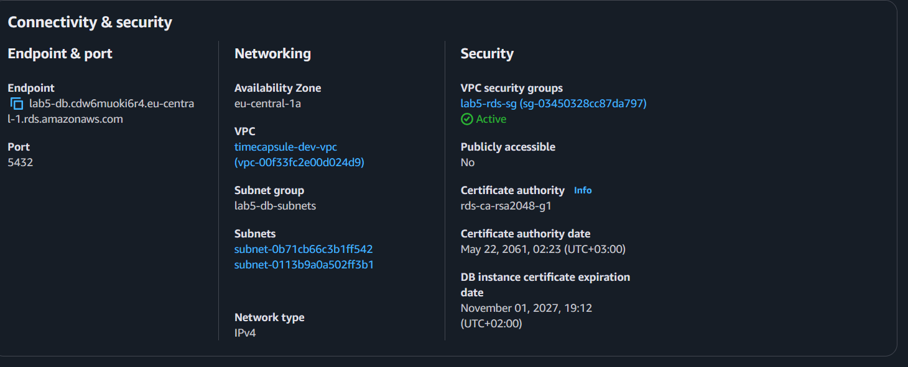

Рисунок 5 — Созданная база данных `lab5-db` в состоянии Available.

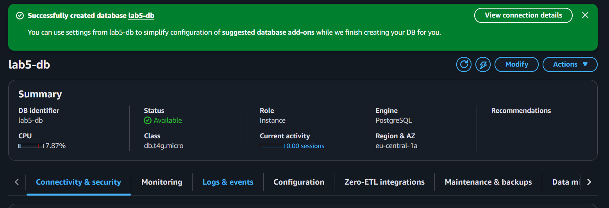

База данных не имеет публичного доступа. Подключение к ней выполняется через приватную сеть VPC, а входящий трафик ограничен группой безопасности. Защита от удаления предотвращает случайное удаление экземпляра через стандартные операции AWS, однако не заменяет резервное копирование и не защищает от удаления или изменения данных внутри самой базы.

## Задание 3. Подключение к базе данных

После создания RDS была настроена возможность подключения к ней с виртуального сервера `web-server`.

Для этого экземпляру EC2 была назначена группа безопасности `lab5-web-sg`. При этом существующая группа безопасности `launch-wizard-2` была сохранена, чтобы не нарушить ранее настроенные правила доступа к серверу.

Рисунок 6 — Назначение группы безопасности `lab5-web-sg` серверу web-server.

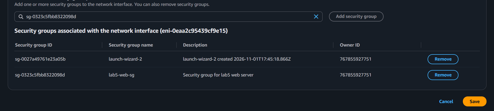

Для подключения использовалась утилита `psql`. Подключение выполнялось по endpoint базы данных с указанием пользователя `dbadmin` и имени базы `lab5`:

```
psql -h <endpoint> -U dbadmin -d lab5
```

После успешного подключения была проверена версия PostgreSQL и информация о текущем соединении:

```
SELECT version();
\conninfo
```

Затем была создана таблица `notes` со следующей структурой:

```
CREATE TABLE notes (
    id         SERIAL PRIMARY KEY,
    body       VARCHAR(100) NOT NULL,
    created_at TIMESTAMPTZ NOT NULL DEFAULT now()
);
```

В таблицу были добавлены три записи: `first`, `second` и `third`. Результат выполнения запроса показал, что все три записи успешно сохранены.

Рисунок 7 — Результат выполнения запроса SELECT к таблице notes.

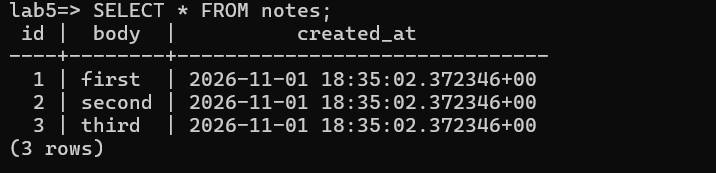

Для определения сетевого адреса базы данных на сервере было выполнено разрешение DNS-имени endpoint. В результате было получено соответствие имени RDS и приватного IP-адреса.

Рисунок 8 — Определение IP-адреса базы данных по endpoint.

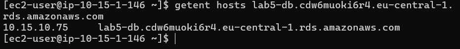

Таким образом, подключение к Amazon RDS с виртуального сервера EC2 было успешно выполнено. Таблица была создана, данные добавлены и прочитаны. Это подтвердило корректность сетевых правил и доступность базы данных из разрешённой сети.

## Задание 4. Создание реплики для чтения

На следующем этапе была создана реплика для чтения `lab5-db-replica` на основе основной базы `lab5-db`.

Реплика была размещена в зоне доступности `eu-central-1b`, тогда как основная база находилась в `eu-central-1a`. Для реплики использовался класс экземпляра `db.t4g.micro`. Публичный доступ был отключён, а для сетевого доступа использовалась группа безопасности `lab5-rds-sg`.

После создания обе базы перешли в состояние `Available`.

Рисунок 9 — Основная база данных и реплика для чтения в AWS RDS.

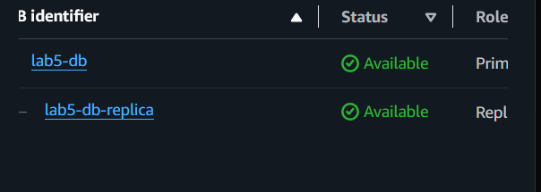

Для проверки работы реплики было выполнено подключение к ней с помощью `psql`. Сначала была выполнена команда:

```
SELECT pg_is_in_recovery();
```

На реплике результатом стало значение `t`, что указывает на работу PostgreSQL в режиме восстановления и подтверждает, что экземпляр является репликой.

Затем была выполнена команда чтения:

```
SELECT * FROM notes;
```

На реплике присутствовали исходные три записи. При попытке добавить новую запись командой:

```
INSERT INTO notes (body) VALUES ('from replica');
```

PostgreSQL вернул ошибку, поскольку реплика предназначена для чтения и не принимает операции изменения данных.

Рисунок 10 — Проверка режима восстановления и попытка записи на реплику.

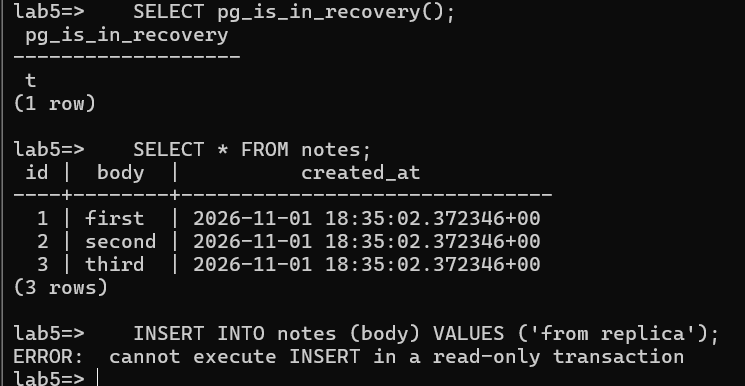

После этого была проверена основная база данных. Для неё команда `SELECT pg_is_in_recovery();` вернула значение `f`, что означает, что основной экземпляр не находится в режиме восстановления и доступен для записи.

В основную базу была добавлена запись `fourth`:

```
INSERT INTO notes (body) VALUES ('fourth');
```

После выполнения запроса таблица содержала четыре записи.

Рисунок 11 — Проверка основной базы и добавление записи fourth.

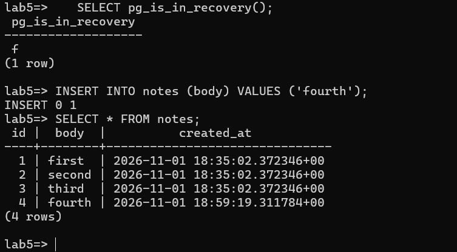

После синхронизации изменения стали доступны и на реплике. Выполнение запроса `SELECT * FROM notes;` на реплике показало четыре записи, включая добавленную запись `fourth`.

Рисунок 12 — Данные на реплике после изменения основной базы.

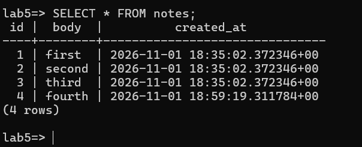

Дополнительно была проверена метрика `ReplicaLag` на вкладке Monitoring. Она отображает задержку репликации в секундах. На графике наблюдалось уменьшение задержки примерно с 30 до 24,8 секунды.

Рисунок 13 — Метрика ReplicaLag для реплики lab5-db-replica.

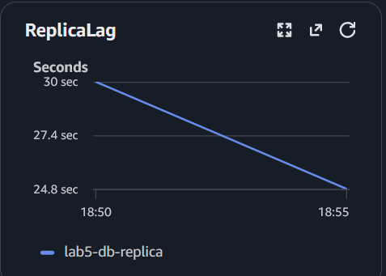

В результате было подтверждено, что реплика получает изменения основной базы с некоторой задержкой и предназначена для выполнения запросов чтения. В отличие от резервного экземпляра Multi-AZ, реплика для чтения может использоваться для распределения нагрузки чтения, а не только для автоматического переключения при отказе основного экземпляра.

После проверки реплика была удалена, поскольку она больше не требовалась для выполнения следующего задания.

Рисунок 14 — Удаление реплики для чтения.

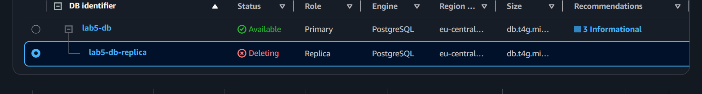

## Задание 5. Восстановление после ошибки

На заключительном этапе базовой части была смоделирована ситуация случайного удаления данных и выполнено восстановление базы с использованием функции Point-in-Time Recovery (PITR) в Amazon RDS.

Сначала на основной базе данных было получено текущее время в UTC:

```
SELECT now() AT TIME ZONE 'UTC';
```

Полученное значение было сохранено для последующего восстановления базы на момент до удаления данных.

Рисунок 15 — Фиксация времени перед удалением данных.

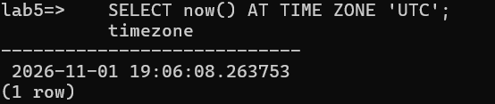

Примерно через минуту после фиксации времени была выполнена команда удаления всех строк таблицы:

```
DELETE FROM notes;
```

После удаления был выполнен запрос:

```
SELECT * FROM notes;
```

Результат показал, что таблица больше не содержит записей.

Рисунок 16 — Удаление всех записей из таблицы notes.

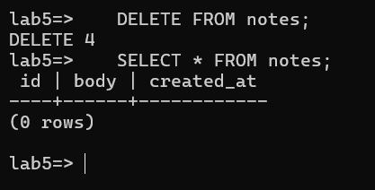

После выполнения удаления было проверено состояние таблицы на реплике. Поскольку реплика получает изменения основной базы, удаление данных также было передано на неё после синхронизации.

Рисунок 17 — Пустая таблица notes после удаления данных.

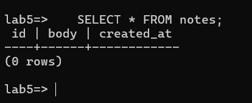

Затем в разделе `Maintenance & backups` основной базы была проверена доступность времени восстановления с помощью параметра `Latest restore time`. После того как необходимый момент стал доступен, было запущено восстановление базы на время, сохранённое до удаления записей.

Для восстановленной базы были заданы следующие параметры:

- идентификатор экземпляра — `lab5-db-restore`;
- класс экземпляра — `db.t4g.micro`;
- группа подсетей — `lab5-db-subnets`;
- публичный доступ — отключён;
- группа безопасности — `lab5-rds-sg`;
- защита от удаления — отключена.

Восстановление было выполнено как создание отдельного экземпляра базы данных. После завершения операции экземпляр `lab5-db-restore` перешёл в состояние `Available`.

Рисунок 18 — Создание восстановленной копии базы данных.

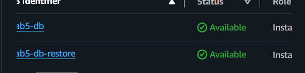

После завершения восстановления была проверена таблица `notes` на новом экземпляре. Данные, существовавшие до удаления, были восстановлены. В таблице присутствовали четыре записи: `first`, `second`, `third` и `fourth`.

[МЕСТО ДЛЯ СКРИНШОТА: результат `SELECT * FROM notes;` на базе `lab5-db-restore`. В архиве отдельного скриншота с этим результатом нет.]

Таким образом, восстановление на определённый момент времени позволило вернуть данные, существовавшие до ошибочного удаления. Реплика не смогла защитить данные от этой операции, поскольку она также синхронизирует изменения основной базы, включая удаление строк. Восстановление через Point-in-Time Recovery создаёт новый экземпляр базы, что позволяет проверить восстановленные данные, не заменяя исходный экземпляр автоматически.

После проверки восстановленная копия была удалена без создания финального снимка и без сохранения резервных копий.

Рисунок 19 — Удаление восстановленной базы lab5-db-restore.

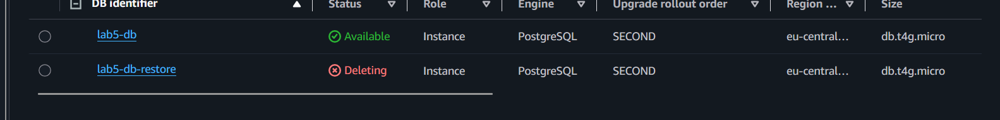

## Вывод

В ходе выполнения базовой части лабораторной работы №5 были изучены основные возможности Amazon RDS for PostgreSQL.

В результате работы:

1. Создана группа подсетей `lab5-db-subnets` с двумя приватными подсетями в разных зонах доступности.
2. Созданы группы безопасности `lab5-web-sg` и `lab5-rds-sg`, ограничивающие сетевой доступ к базе данных.
3. Создан экземпляр RDS `lab5-db` с PostgreSQL, отключённым публичным доступом, шифрованием и автоматическим резервным копированием.
4. Выполнено подключение к базе с виртуального сервера EC2 с помощью `psql`.
5. Создана таблица `notes`, добавлены и прочитаны тестовые записи.
6. Создана реплика для чтения `lab5-db-replica`, проверена её работа и задержка репликации.
7. Смоделировано случайное удаление данных и выполнено восстановление базы на момент времени до удаления с помощью Point-in-Time Recovery.
8. После завершения проверки временные ресурсы — реплика и восстановленная копия — были удалены.

В ходе работы было установлено, что размещение базы данных в приватной сети и использование Security Groups позволяют ограничить доступ к PostgreSQL только необходимыми серверами. Реплика для чтения позволяет распределять нагрузку запросов чтения, но не защищает от ошибочного изменения или удаления данных. Для восстановления данных после подобных ситуаций необходимо использовать резервные копии и механизм восстановления на определённый момент времени.

Базовая часть лабораторной работы позволила получить практический опыт создания, настройки, использования и восстановления базы данных Amazon RDS.