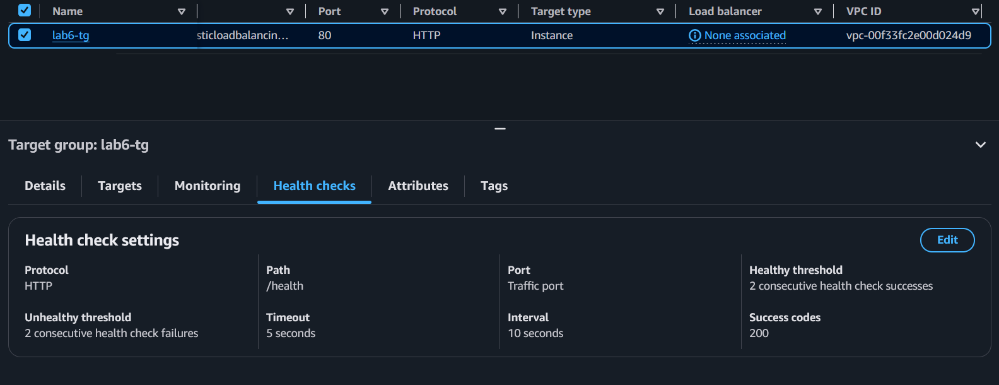
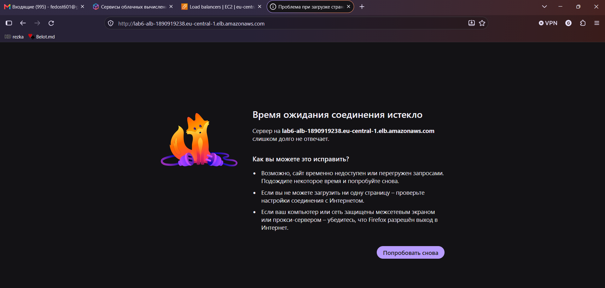
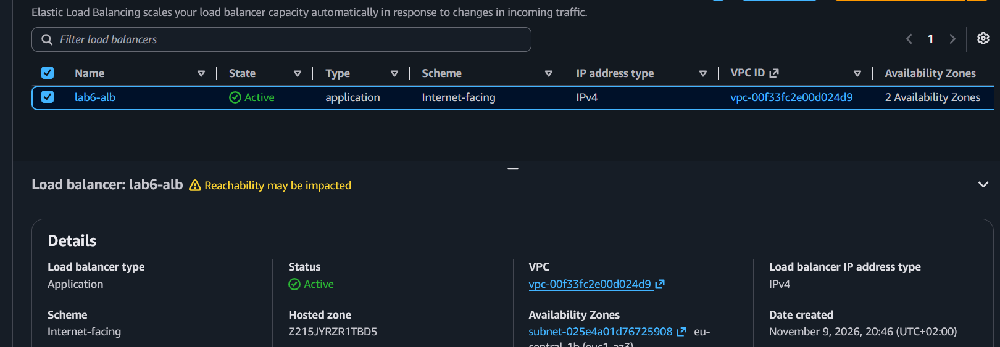
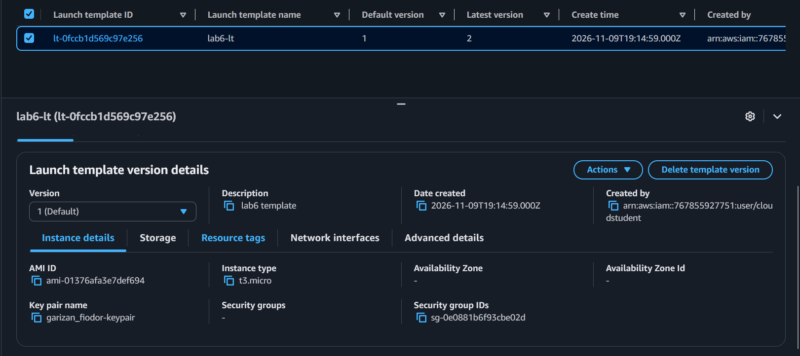
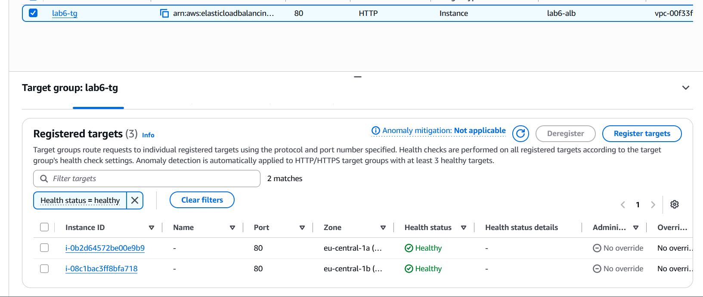

# Лабораторная работа №6. Масштабирование и балансировка нагрузки

**Тема:** Elastic Load Balancing, Amazon EC2 Auto Scaling
**Уровень:** базовый (Часть 1, задания 1-3)
**Регион:** eu-central-1
**VPC:** `vpc-00f33fc2e00d024d9` (из ЛР3)

## Цель работы

Научиться распределять запросы между серверами с помощью Application Load Balancer и поручать Amazon EC2 Auto Scaling добавлять и убирать серверы по нагрузке.

## Созданные ресурсы

| Ресурс | Имя | Назначение |
|---|---|---|
| Security group | `lab6-alb-sg` (`sg-0696e1649ac1a647f`) | Вход HTTP 80 из любого места для балансировщика |
| Security group | `lab6-instance-sg` (`sg-0e0881b6f93cbe02d`) | HTTP 80 только от `lab6-alb-sg`, SSH 22 только от группы bastion |
| Target group | `lab6-tg` | Целевая группа: HTTP 80, проверка `/health` каждые 10 с |
| Load balancer | `lab6-alb` | Application Load Balancer, Internet-facing, подсети public-a и public-b |
| Launch template | `lab6-lt` | Шаблон: Amazon Linux 2023, t3.micro, user data с nginx |
| Auto Scaling group | `lab6-asg` | От 2 до 4 серверов в двух зонах |
| Scaling policy | `lab6-target-tracking` | Target tracking: Request count per target = 50 |

Все ресурсы имеют тег `Lab = lab6`.

---

## Подготовка. Группы безопасности

Созданы две группы безопасности в VPC из ЛР3:

- `lab6-alb-sg`: Inbound HTTP, TCP 80, источник `0.0.0.0/0`.
- `lab6-instance-sg`: Inbound HTTP, TCP 80, источник `lab6-alb-sg`; SSH, TCP 22, источник группа безопасности bastion. Так серверы принимают HTTP только от балансировщика, а SSH только с bastion.

---

## Задание 1. Балансировщик

### 1.1. Целевая группа `lab6-tg`

Тип целей Instances, протокол HTTP, порт 80. Проверка работоспособности: протокол HTTP, путь `/health`, порт Traffic port, интервал 10 секунд, таймаут 5 секунд, порог здоровья 2, порог нездоровья 2, успешный код 200.



### 1.2. Балансировщик `lab6-alb`

Application Load Balancer, схема Internet-facing, IPv4, VPC `vpc-00f33fc2e00d024d9`, две зоны (подсети public-a и public-b), группа безопасности `lab6-alb-sg`. Listener: HTTP 80 → forward в `lab6-tg`.



### 1.3. Открытие DNS-имени балансировщика

DNS name: `lab6-alb-1890919238.eu-central-1.elb.amazonaws.com`

На момент проверки серверов в целевой группе ещё не было. В моём случае браузер показал таймаут соединения (балансировщик только что создан, на странице отображалось предупреждение «Reachability may be impacted»; при готовом балансировщике без исправных серверов ожидается ответ 503).



### Ответ на вопрос

**Какой ответ вернул балансировщик и почему?** Когда балансировщик полностью запущен, а в целевой группе нет ни одного исправного сервера, он возвращает ошибку **503 Service Temporarily Unavailable**: сам балансировщик работает, но передать запрос некому. В моём случае первое обращение завершилось таймаутом, так как балансировщик ещё инициализировался.

**Зачем ему подсети в двух зонах?** Для отказоустойчивости. Если одна зона доступности выйдет из строя, балансировщик продолжит принимать и распределять запросы через вторую. Для Application Load Balancer AWS требует минимум две зоны.

---

## Задание 2. Группа Auto Scaling

### 2.1. Шаблон запуска `lab6-lt`

Параметры шаблона:

- AMI: Amazon Linux 2023 (`ami-01376afa3e7def694`);
- тип: `t3.micro`;
- пара ключей: `garizan_fiodor-keypair`;
- подсеть и зона доступности: **Don't include in launch template** (их выбирает группа);
- security group: только `lab6-instance-sg`;
- Auto-assign public IP: Enable (серверам нужен интернет, чтобы установить nginx);
- тег ресурсов: `Lab = lab6` для Instances;
- User data:

```bash
#!/bin/bash
dnf install -y nginx
TOKEN=$(curl -s -X PUT "http://169.254.169.254/latest/api/token" -H "X-aws-ec2-metadata-token-ttl-seconds: 300")
AZ=$(curl -s -H "X-aws-ec2-metadata-token: $TOKEN" http://169.254.169.254/latest/meta-data/placement/availability-zone)
echo "<h1>$(hostname)</h1><p>Zone: $AZ</p>" > /usr/share/nginx/html/index.html
echo "OK" > /usr/share/nginx/html/health
systemctl enable --now nginx
```



### 2.2. Группа `lab6-asg`

- шаблон `lab6-lt`, последняя версия;
- подсети public-a и public-b;
- целевая группа `lab6-tg`;
- включены проверки Elastic Load Balancing (ELB health checks);
- размер группы: Desired 2, Min 2, Max 4;
- тег `Lab = lab6`.

### 2.3. Политика масштабирования

Тип Target tracking scaling, имя `lab6-target-tracking`, метрика Application Load Balancer request count per target, целевая группа `lab6-tg`, целевое значение **50**. Опция Disable scale in не включалась, чтобы группа могла уменьшаться.

### 2.4. Проблема: серверы были unhealthy

После создания группы оба сервера получили статус **Unhealthy** (Health checks failed), группа начала их заменять. Диагностика:

1. В системном логе сервера (Actions → Monitor and troubleshoot → Get system log) cloud-init завершился за 7 секунд, без установки nginx. Значит, user data на сервере не выполнился.
2. Шаблон был исправлен: создана версия 2 с корректным User data и без зафиксированной зоны доступности, группа переключена на эту версию, старые серверы завершены. Группа запустила новые.

После этого оба сервера перешли в состояние **Healthy**.

### 2.5. Проверка целей

В `lab6-tg` два сервера в состоянии Healthy, по одному в каждой зоне: `i-0b2d64572be00e9b9` (eu-central-1a) и `i-08c1bac3ff8bfa718` (eu-central-1b).



### 2.6. Страница балансировщика

При обновлении страницы балансировщика отвечают разные серверы: меняются имя хоста и зона.

### Ответы на вопросы

**Чем группа Auto Scaling отличается от целевой группы?** Целевая группа знает, каким серверам балансировщик передаёт запросы, и проверяет их работоспособность. Группа Auto Scaling создаёт и удаляет сами серверы, следит за их количеством и регистрирует новые серверы в целевой группе.

**Почему в шаблоне нет подсети?** Подсеть и зону выбирает группа Auto Scaling из указанных ей подсетей и распределяет серверы между зонами. Если зафиксировать подсеть или зону в шаблоне, все серверы окажутся в одной зоне, и отказоустойчивость пропадёт.

---

## Задание 3. Нагрузка

### 3.1. Запуск нагрузки

С bastion (или с компьютера) в течение 10 минут запускался скрипт:

```bash
ALB=lab6-alb-1890919238.eu-central-1.elb.amazonaws.com
end=$((SECONDS+600)); while [ $SECONDS -lt $end ]; do curl -s -o /dev/null http://$ALB/; done
```

### 3.2. Тревоги CloudWatch

Политика target tracking автоматически создала в CloudWatch две тревоги: `AlarmHigh` (запросов слишком много, добавляет серверы) и `AlarmLow` (запросов мало, убирает лишние). Во время нагрузки тревога `AlarmHigh` перешла в состояние **ALARM** в `<ВРЕМЯ>`.

### 3.3. История группы

На вкладке Activity группы `lab6-asg` видно, что группа запустила `<N>` новых серверов. В поле Cause указано, что причина: тревога `AlarmHigh` политики `lab6-target-tracking`.

### 3.4. Возврат к двум серверам

После окончания нагрузки сработала тревога `AlarmLow`, и группа вернулась к двум серверам примерно через `<N>` минут.

### Ответы на вопросы

**Сколько серверов запустила группа и почему не больше четырёх?** Группа запустила `<N>` серверов (итого `<M>` в группе). Больше четырёх быть не может, так как максимальный размер группы Max = 4 ограничивает рост, как бы ни выросла метрика.

**Почему метрика упала после запуска новых серверов, хотя запросов не стало меньше?** Метрика RequestCountPerTarget считается на один сервер: общее число запросов делится на число серверов в целевой группе. Когда серверов стало больше, на каждый пришлось меньше запросов.

**Почему группа добавляет серверы быстрее, чем убирает?** Для добавления достаточно нескольких минут повышенной нагрузки, а для уменьшения тревога AlarmLow должна подряд находиться в состоянии низкой нагрузки значительно дольше (около 15 минут). Так сделано намеренно: нехватка серверов бьёт по пользователям, а лишний сервер стоит дёшево. Кроме того, это защищает от «качелей», когда группа то растёт, то уменьшается.

---

## Завершение работы

Чтобы не платить за балансировщик, все ресурсы были удалены в таком порядке:

1. группа Auto Scaling `lab6-asg` (серверы удалились вместе с ней);
2. балансировщик `lab6-alb`;
3. целевая группа `lab6-tg`;
4. шаблон запуска `lab6-lt`;
5. группы безопасности `lab6-instance-sg`, затем `lab6-alb-sg`.

---

## Вывод

В ходе работы был создан Application Load Balancer, который распределяет запросы между серверами в двух зонах доступности, и группа Auto Scaling, которая держит от двух до четырёх серверов и меняет их количество по метрике запросов на один сервер. Нагрузочный тест показал, что группа добавляет серверы при росте нагрузки и убирает их после её окончания. При настройке возникла проблема: серверы были unhealthy из-за того, что user data не выполнился. Она была найдена по системному логу и устранена созданием новой версии шаблона. По завершении работы все ресурсы удалены.
